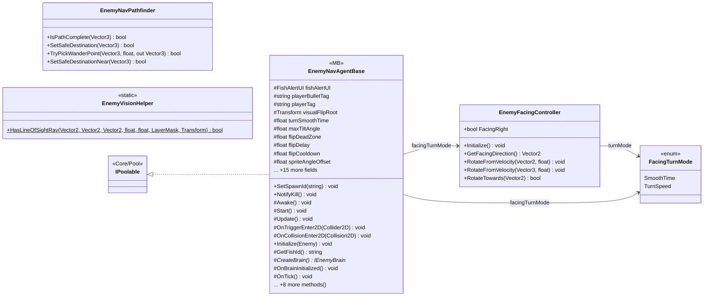

# Gameplay/Entitys/Enemys/NavAgents/Core

5 types · 464 LOC (non-blank) · depends on: [Gameplay/Entitys/Enemys/NavAgents](Gameplay_Entitys_Enemys_NavAgents.md) ×2, [Core/Interfaces](Core_Interfaces.md) ×1, [Gameplay/Entitys/Enemys/Brain](Gameplay_Entitys_Enemys_Brain.md) ×1, [Gameplay/Entitys/Enemys](Gameplay_Entitys_Enemys.md) ×1, [Gameplay/Entitys/Enemys/Beharviours](Gameplay_Entitys_Enemys_Beharviours.md) ×1, [Gameplay/Entitys/Players](Gameplay_Entitys_Players.md) ×1, [Core/Pool](Core_Pool.md) ×1, [Core](Core.md) ×1, [Core/Save Game/DayAndResetEnemys](Core_Save_Game_DayAndResetEnemys.md) ×1

[← index](../README.md)

## Files

| Type | Kind | File | LOC |
|---|---|---|---|
| EnemyFacingController | class | `EnemyFacingController.cs:8` | 109 |
| EnemyNavAgentBase | MB, abstract | `EnemyNavAgentBase.cs:6` | 228 |
| EnemyNavPathfinder | class | `EnemyNavPathfinder.cs:9` | 106 |
| EnemyVisionHelper | static | `EnemyVisionHelper.cs:5` | 21 |
| FacingTurnMode | enum | `EnemyFacingController.cs:34` | 5 |
