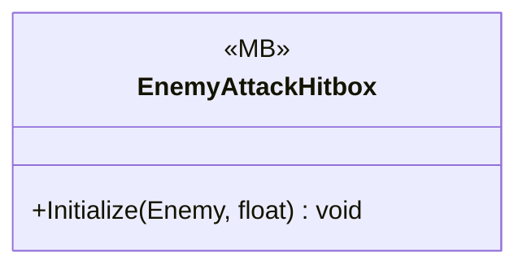

# Gameplay/Entitys/Enemys/Partbraked

1 types · 19 LOC (non-blank) · depends on: [Gameplay/Entitys/Enemys](Gameplay_Entitys_Enemys.md) ×1, [Gameplay/Entitys/Players](Gameplay_Entitys_Players.md) ×1

[← index](../README.md)

## Files

| Type | Kind | File | LOC |
|---|---|---|---|
| EnemyAttackHitbox | MB | `EnemyAttackHitbox.cs:5` | 19 |
