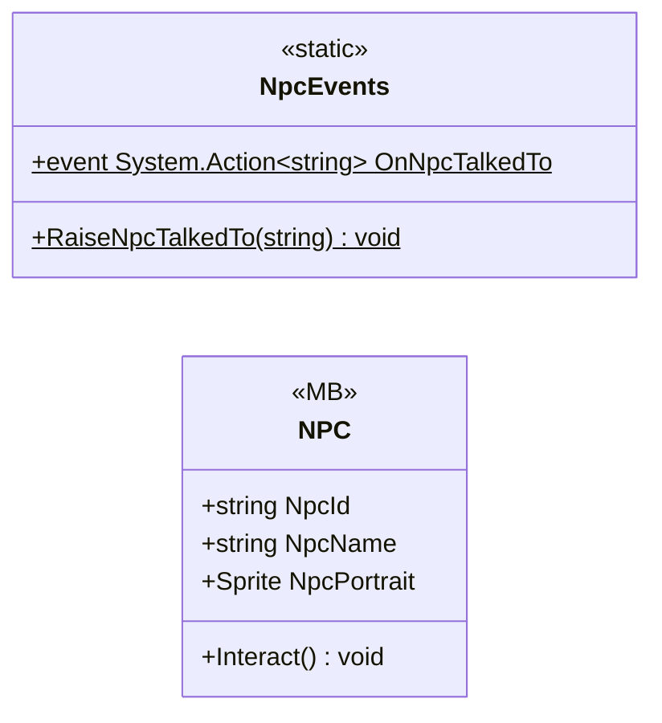

# Gameplay/Entitys/NPCs

2 types · 246 LOC (non-blank) · depends on: [Gameplay/QuestSystems/Quest](Gameplay_QuestSystems_Quest.md) ×7, [Core](Core.md) ×2, [Gameplay/Cutscenes](Gameplay_Cutscenes.md) ×2, [UI/Interactions](UI_Interactions.md) ×1, [UI/LoadingSecne](UI_LoadingSecne.md) ×1, [Gameplay/Environments](Gameplay_Environments.md) ×1, [UI](UI.md) ×1, [Core/Datas/ScriptableDatas/Quests/QuestBoard](Core_Datas_ScriptableDatas_Quests_QuestBoard.md) ×1

[← index](../README.md)

## Event subscriptions

| Subscriber | Publisher | Event |
|---|---|---|
| NPC | InteractUI | PlayerExited |
| NPC | QuestManager | OnQuestUpdated |

## Files

| Type | Kind | File | LOC |
|---|---|---|---|
| NPC | MB | `NPC.cs:18` | 238 |
| NpcEvents | static | `NPC.cs:8` | 8 |
