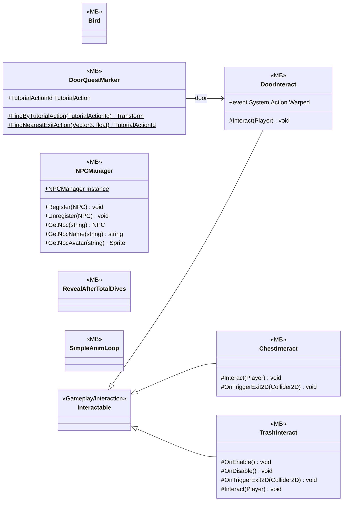

# Gameplay/Environments

8 types · 403 LOC (non-blank) · depends on: [Gameplay/Entities/Players](Gameplay_Entities_Players.md) ×6, [Gameplay/AudioSetting](Gameplay_AudioSetting.md) ×4, [Gameplay/QuestSystems/Quest](Gameplay_QuestSystems_Quest.md) ×4, [Gameplay/Interaction](Gameplay_Interaction.md) ×3, [Core/Events](Core_Events.md) ×2, [Core/Save/DayReset](Core_Save_DayReset.md) ×2, [Gameplay/Contracts](Gameplay_Contracts.md) ×2, [Core/Datas/ScriptableDatas/Characters](Core_Datas_ScriptableDatas_Characters.md) ×1, [Gameplay/Entities/NPCs](Gameplay_Entities_NPCs.md) ×1

[← index](../README.md)

## Event subscriptions

| Subscriber | Publisher | Event |
|---|---|---|
| DoorQuestMarker | DoorInteract | Warped |
| DoorQuestMarker | QuestManager | OnQuestUpdated |
| TrashInteract | DayManager | OnDayAdvanced |

## Files

| Type | Kind | File | LOC |
|---|---|---|---|
| Bird | MB | `Bird.cs:6` | 32 |
| ChestInteract | MB | `ChestInteract.cs:8` | 53 |
| DoorInteract | MB | `DoorInteract.cs:8` | 44 |
| DoorQuestMarker | MB | `DoorQuestMarker.cs:9` | 76 |
| NPCManager | MB | `NPCManager.cs:17` | 44 |
| RevealAfterTotalDives | MB | `RevealAfterTotalDives.cs:11` | 9 |
| SimpleAnimLoop | MB | `SimpleAnimLoop.cs:8` | 36 |
| TrashInteract | MB | `TrashInteract.cs:7` | 109 |
