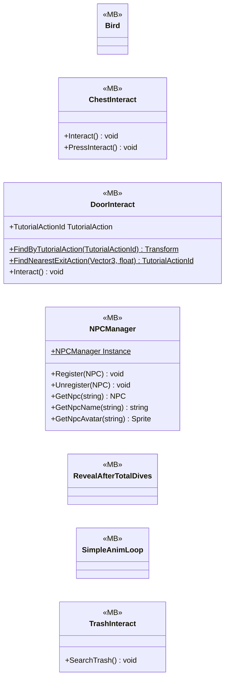

# Gameplay/Environments

7 types · 480 LOC (non-blank) · depends on: [Gameplay/QuestSystems/Quest](Gameplay_QuestSystems_Quest.md) ×6, [Gameplay/AudioSetting](Gameplay_AudioSetting.md) ×4, [Core](Core.md) ×3, [Gameplay/Entitys/Players](Gameplay_Entitys_Players.md) ×2, [Core/Save Game/DayAndResetEnemys](Core_Save_Game_DayAndResetEnemys.md) ×2, [UI/Interactions](UI_Interactions.md) ×1, [Core/Datas/ScriptableDatas/Characters](Core_Datas_ScriptableDatas_Characters.md) ×1, [Gameplay/Entitys/NPCs](Gameplay_Entitys_NPCs.md) ×1

[← index](../README.md)

## Event subscriptions

| Subscriber | Publisher | Event |
|---|---|---|
| DoorInteract | QuestManager | OnQuestUpdated |
| TrashInteract | DayManager | OnDayAdvanced |

## Files

| Type | Kind | File | LOC |
|---|---|---|---|
| Bird | MB | `Bird.cs:5` | 32 |
| ChestInteract | MB | `ChestInteract.cs:15` | 97 |
| DoorInteract | MB | `DoorInteract.cs:8` | 132 |
| NPCManager | MB | `NPCManager.cs:16` | 44 |
| RevealAfterTotalDives | MB | `RevealAfterTotalDives.cs:10` | 9 |
| SimpleAnimLoop | MB | `SimpleAnimLoop.cs:7` | 36 |
| TrashInteract | MB | `TrashInteract.cs:8` | 130 |
