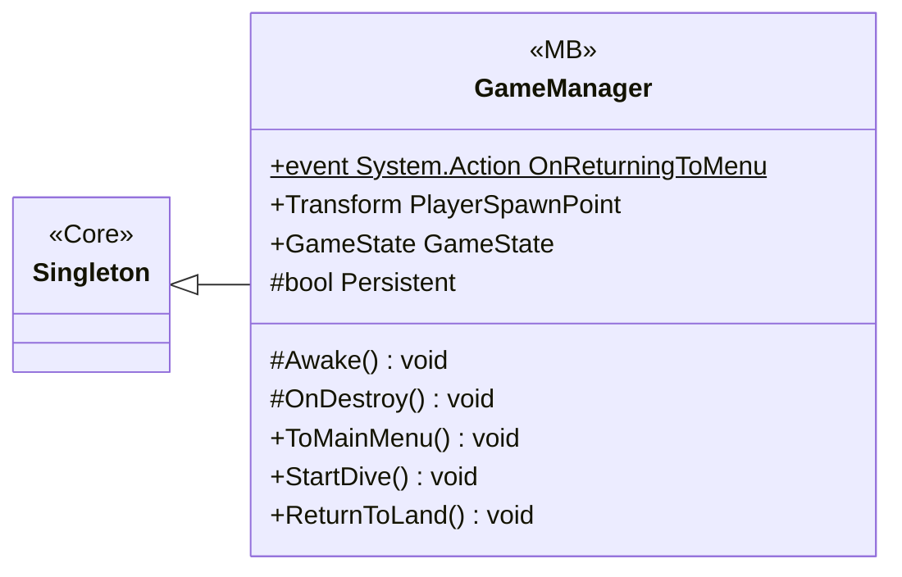

# Gameplay/Game

1 types · 124 LOC (non-blank) · depends on: [Core](Core.md) ×6, [Core/Events](Core_Events.md) ×5, [Core/Scenes](Core_Scenes.md) ×3, [Gameplay/Entities/Players](Gameplay_Entities_Players.md) ×2, [Core/Save/DayReset](Core_Save_DayReset.md) ×1, [Gameplay/Services](Gameplay_Services.md) ×1

[← index](../README.md)

## Event subscriptions

| Subscriber | Publisher | Event |
|---|---|---|
| GameManager | GameFlowEvents | OnReturnToLandRequested |

## Files

| Type | Kind | File | LOC |
|---|---|---|---|
| GameManager | MB | `GameManager.cs:7` | 124 |
