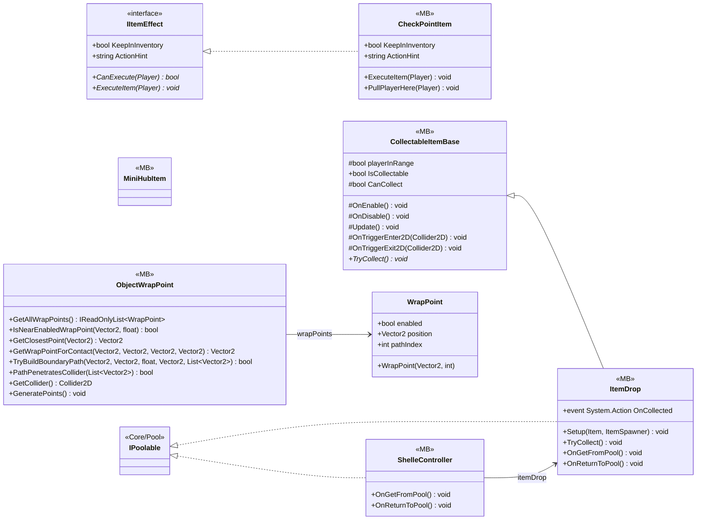

# Gameplay/InteractObjects

8 types · 794 LOC (non-blank) · depends on: [Core](Core.md) ×4, [Core/Pool](Core_Pool.md) ×3, [UI/Inventory](UI_Inventory.md) ×2, [Gameplay/Entities/Players](Gameplay_Entities_Players.md) ×2, [Gameplay/AudioSetting](Gameplay_AudioSetting.md) ×2, [Core/Inputs](Core_Inputs.md) ×1, [Core/Services](Core_Services.md) ×1, [Gameplay/QuestSystems/Quest](Gameplay_QuestSystems_Quest.md) ×1, [Core/Datas/Items](Core_Datas_Items.md) ×1, [Core/Save/DayReset](Core_Save_DayReset.md) ×1

[← index](../README.md)

## Event subscriptions

| Subscriber | Publisher | Event |
|---|---|---|
| CollectableItemBase | InputReader | OnInteracted |
| ShelleController | ItemDrop | OnCollected |

## Files

| Type | Kind | File | LOC |
|---|---|---|---|
| CheckPointItem | MB | `CheckPointItem.cs:10` | 91 |
| CollectableItemBase | MB, abstract | `CollectableItemBase.cs:7` | 70 |
| IItemEffect | interface | `IItemEffect.cs:3` | 7 |
| ItemDrop | MB | `ItemDrop.cs:7` | 51 |
| MiniHubItem | MB | `MiniHubItem.cs:5` | 10 |
| ObjectWrapPoint | MB | `ObjectWrapPoint.cs:5` | 467 |
| ShelleController | MB | `ShelleController.cs:6` | 98 |
| WrapPoint | class | `ObjectWrapPoint.cs:7` | 11 |
