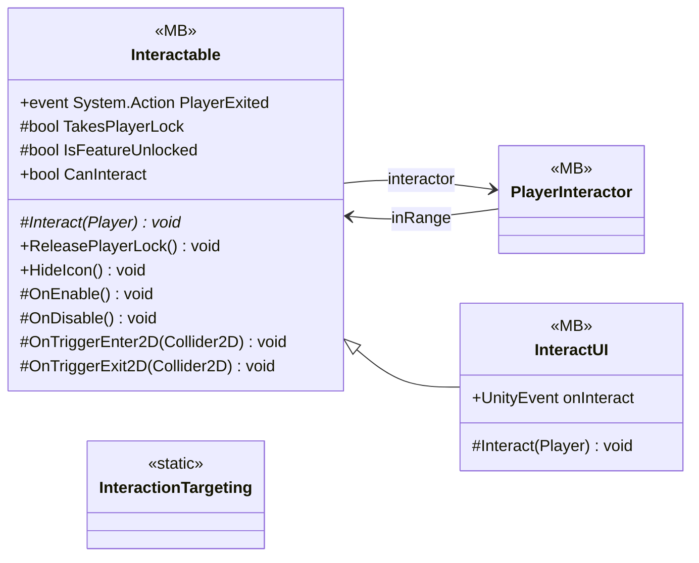

# Gameplay/Interaction

4 types · 147 LOC (non-blank) · depends on: [Core/Events](Core_Events.md) ×3, [Gameplay/Entities/Players](Gameplay_Entities_Players.md) ×3, [Core](Core.md) ×2, [Gameplay/QuestSystems/Quest](Gameplay_QuestSystems_Quest.md) ×2, [Core/Inputs](Core_Inputs.md) ×1, [Core/Scenes](Core_Scenes.md) ×1, [Gameplay/Cutscenes](Gameplay_Cutscenes.md) ×1, [Gameplay/Services](Gameplay_Services.md) ×1

[← index](../README.md)

## Event subscriptions

| Subscriber | Publisher | Event |
|---|---|---|
| PlayerInteractor | InputReader | OnInteracted |

## Files

| Type | Kind | File | LOC |
|---|---|---|---|
| InteractUI | MB | `InteractUI.cs:10` | 6 |
| Interactable | MB, abstract | `Interactable.cs:8` | 75 |
| InteractionTargeting | static | `InteractionTargeting.cs:8` | 19 |
| PlayerInteractor | MB | `PlayerInteractor.cs:9` | 47 |
