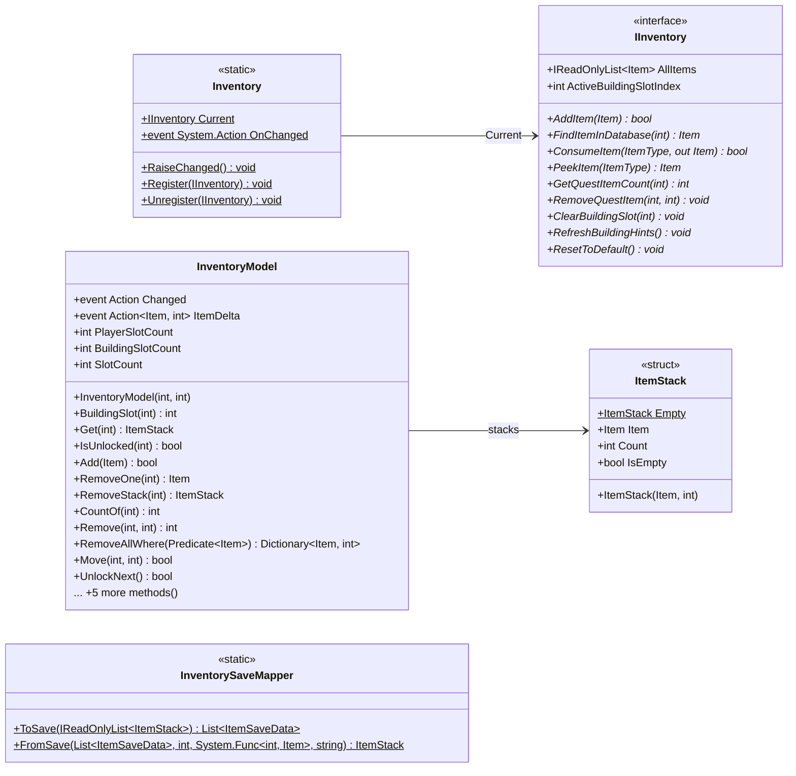

# Gameplay/Inventory

5 types · 224 LOC (non-blank) · depends on: [Core/Data/Items](Core_Data_Items.md) ×6, [Core/Save](Core_Save.md) ×1

[← index](../README.md)

## Files

| Type | Kind | File | LOC |
|---|---|---|---|
| IInventory | interface | `IInventory.cs:7` | 14 |
| Inventory | static | `Inventory.cs:6` | 11 |
| InventoryModel | class | `InventoryModel.cs:8` | 142 |
| InventorySaveMapper | static | `InventorySaveMapper.cs:8` | 45 |
| ItemStack | struct | `ItemStack.cs:6` | 12 |
