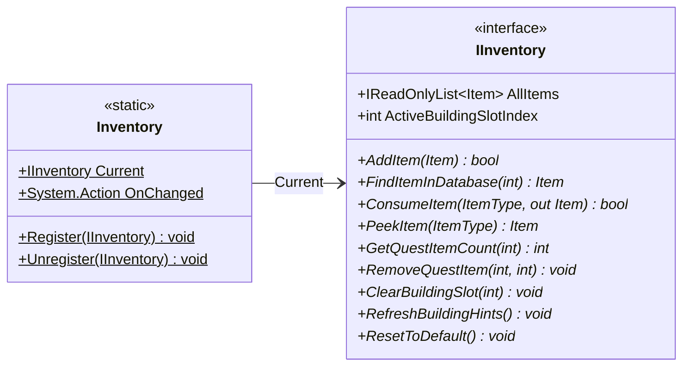

# Gameplay/Inventory

2 types · 24 LOC (non-blank) · depends on: [Core/Datas/Items](Core_Datas_Items.md) ×2

[← index](../README.md)

## Files

| Type | Kind | File | LOC |
|---|---|---|---|
| IInventory | interface | `IInventory.cs:7` | 14 |
| Inventory | static | `Inventory.cs:6` | 10 |
