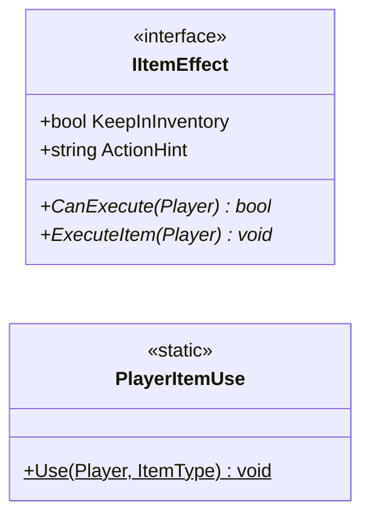

# Gameplay/Items

2 types · 55 LOC (non-blank) · depends on: [Gameplay/Entities/Players](Gameplay_Entities_Players.md) ×2, [Core/Datas/Items](Core_Datas_Items.md) ×2, [Core/Events](Core_Events.md) ×2, [Core](Core.md) ×1, [Gameplay/Inventory](Gameplay_Inventory.md) ×1

[← index](../README.md)

## Files

| Type | Kind | File | LOC |
|---|---|---|---|
| IItemEffect | interface | `IItemEffect.cs:5` | 7 |
| PlayerItemUse | static | `PlayerItemUse.cs:7` | 48 |
