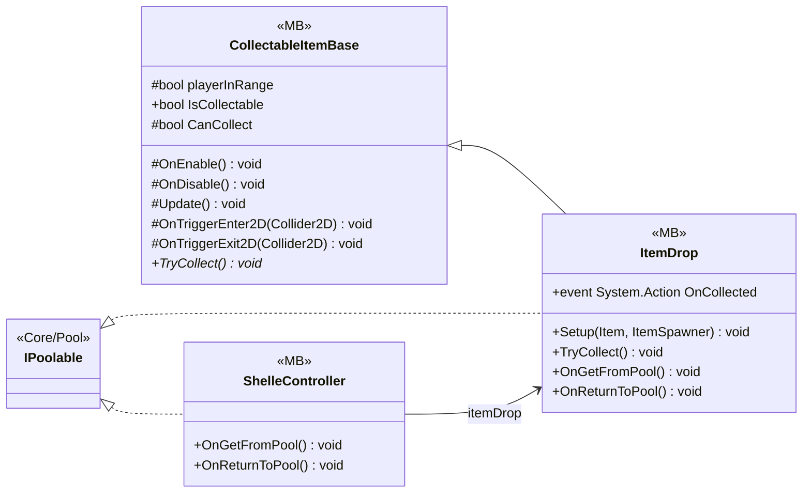

# Gameplay/Items/Pickups

3 types · 219 LOC (non-blank) · depends on: [Core/Pool](Core_Pool.md) ×3, [Core](Core.md) ×2, [Gameplay/AudioSetting](Gameplay_AudioSetting.md) ×2, [Gameplay/Services](Gameplay_Services.md) ×1, [Gameplay/QuestSystems/Quest](Gameplay_QuestSystems_Quest.md) ×1, [Core/Inputs](Core_Inputs.md) ×1, [Core/Datas/Items](Core_Datas_Items.md) ×1, [Gameplay/Spawning](Gameplay_Spawning.md) ×1, [Gameplay/Inventory](Gameplay_Inventory.md) ×1

[← index](../README.md)

## Event subscriptions

| Subscriber | Publisher | Event |
|---|---|---|
| CollectableItemBase | InputReader | OnInteracted |
| ShelleController | ItemDrop | OnCollected |

## Files

| Type | Kind | File | LOC |
|---|---|---|---|
| CollectableItemBase | MB, abstract | `CollectableItemBase.cs:7` | 70 |
| ItemDrop | MB | `ItemDrop.cs:7` | 51 |
| ShelleController | MB | `ShelleController.cs:7` | 98 |
