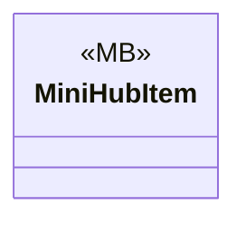

# Gameplay/Items/Placeables

1 types · 4 LOC (non-blank) · depends on: [Gameplay/Entities/Players](Gameplay_Entities_Players.md) ×1

[← index](../README.md)

## Files

| Type | Kind | File | LOC |
|---|---|---|---|
| MiniHubItem | MB | `MiniHubItem.cs:5` | 4 |
