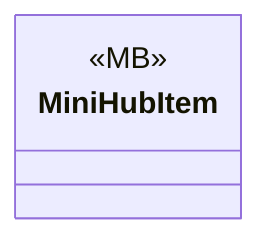

# Gameplay/Items/Placeables

1 types · 10 LOC (non-blank) · depends on: [Gameplay/Game](Gameplay_Game.md) ×1

[← index](../README.md)

## Files

| Type | Kind | File | LOC |
|---|---|---|---|
| MiniHubItem | MB | `MiniHubItem.cs:6` | 10 |
