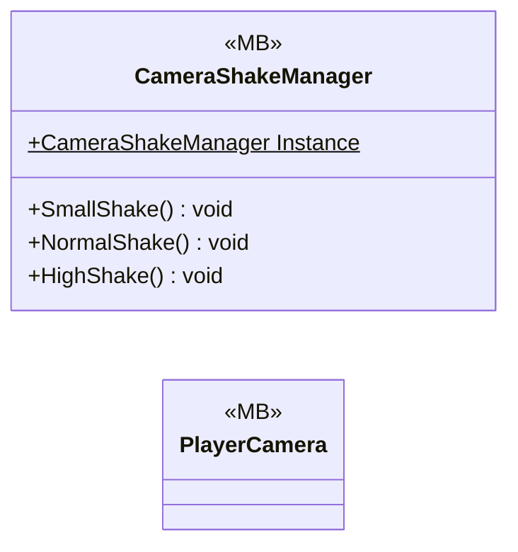

# Gameplay/MainCameras

2 types · 40 LOC (non-blank) · depends on: [Gameplay/Entities/Players](Gameplay_Entities_Players.md) ×1

[← index](../README.md)

## Files

| Type | Kind | File | LOC |
|---|---|---|---|
| CameraShakeManager | MB | `CameraShakeManager.cs:7` | 17 |
| PlayerCamera | MB | `PlayerCamera.cs:9` | 23 |
