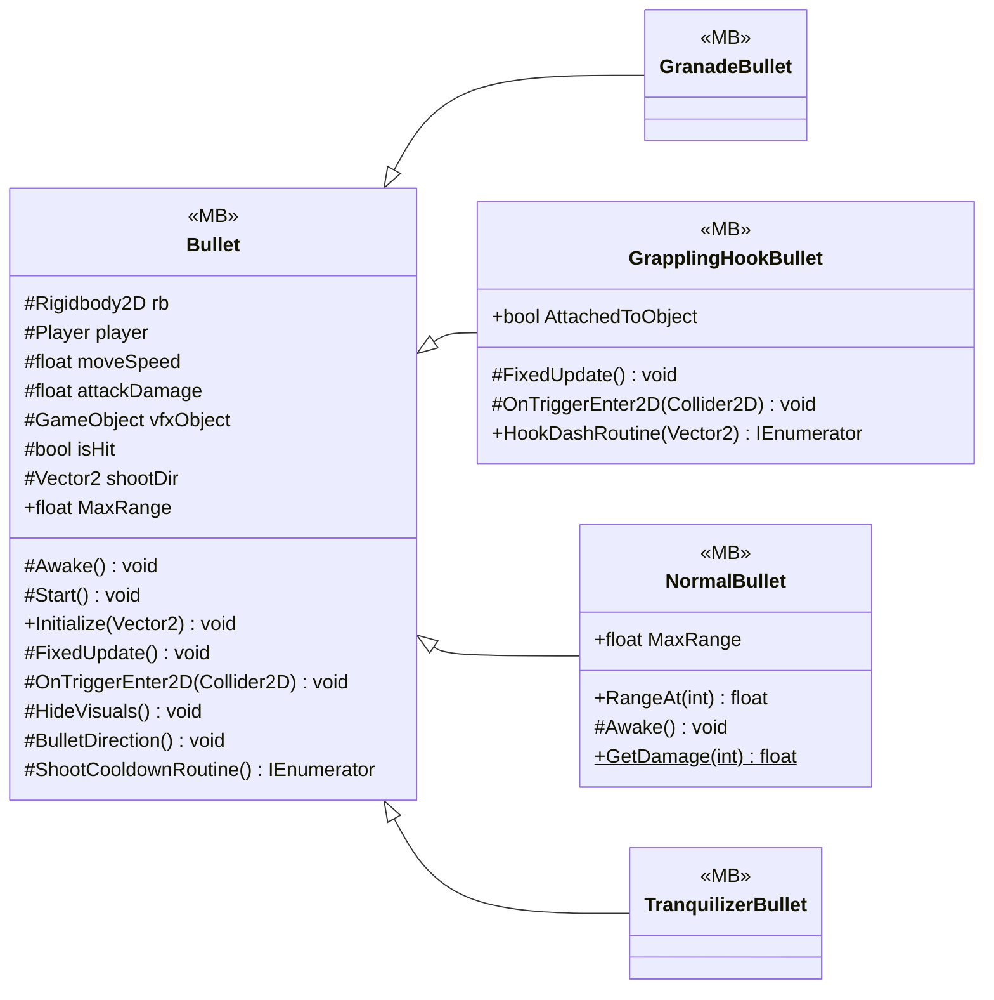

# Gameplay/Projectiles

5 types · 226 LOC (non-blank) · depends on: [Gameplay/QuestSystems/Quest](Gameplay_QuestSystems_Quest.md) ×3, [Gameplay/Entitys/Enemys](Gameplay_Entitys_Enemys.md) ×2, [Core](Core.md) ×2, [Core/Interfaces](Core_Interfaces.md) ×1, [Gameplay/Entitys/Players](Gameplay_Entitys_Players.md) ×1, [UI/Interactions](UI_Interactions.md) ×1, [Gameplay/RopeSystems](Gameplay_RopeSystems.md) ×1, [Core/Services](Core_Services.md) ×1, [UI/Upgrads](UI_Upgrads.md) ×1

[← index](../README.md)

## Files

| Type | Kind | File | LOC |
|---|---|---|---|
| Bullet | MB, abstract | `Bullet.cs:6` | 72 |
| GranadeBullet | MB | `GranadeBullet.cs:3` | 1 |
| GrapplingHookBullet | MB | `GrapplingHookBullet.cs:6` | 100 |
| NormalBullet | MB | `NormalBullet.cs:5` | 52 |
| TranquilizerBullet | MB | `TranquilizerBullet.cs:3` | 1 |
