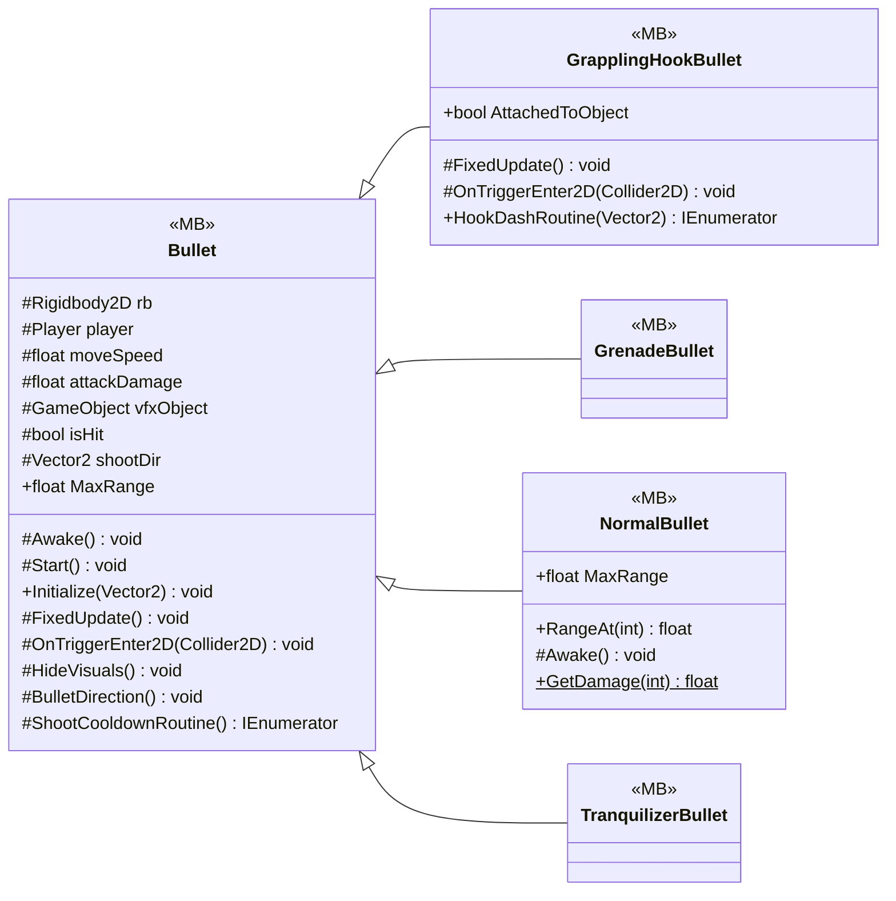

# Gameplay/Projectiles

5 types · 222 LOC (non-blank) · depends on: [Gameplay/Entities](Gameplay_Entities.md) ×3, [Gameplay/Entities/Players](Gameplay_Entities_Players.md) ×3, [Core/Events](Core_Events.md) ×2, [Core](Core.md) ×1, [Core/Datas/Upgrades](Core_Datas_Upgrades.md) ×1, [Gameplay/RopeSystems](Gameplay_RopeSystems.md) ×1, [Gameplay/Services](Gameplay_Services.md) ×1

[← index](../README.md)

## Files

| Type | Kind | File | LOC |
|---|---|---|---|
| Bullet | MB, abstract | `Bullet.cs:7` | 69 |
| GrapplingHookBullet | MB | `GrapplingHookBullet.cs:7` | 99 |
| GrenadeBullet | MB | `GrenadeBullet.cs:5` | 1 |
| NormalBullet | MB | `NormalBullet.cs:6` | 52 |
| TranquilizerBullet | MB | `TranquilizerBullet.cs:5` | 1 |
