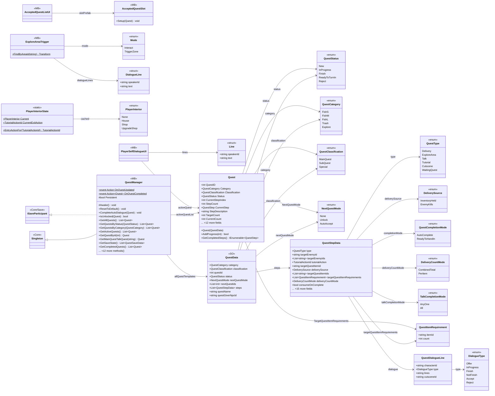
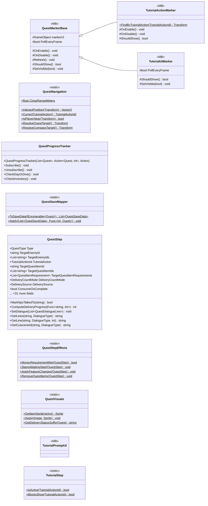

# Gameplay/QuestSystems/Quest

36 types · 1722 LOC (non-blank) · depends on: [Core/Events](Core_Events.md) ×21, [Core](Core.md) ×12, [Gameplay/Entities/Players](Gameplay_Entities_Players.md) ×6, [Core/Save](Core_Save.md) ×4, [Gameplay/Environments](Gameplay_Environments.md) ×4, [Gameplay/Inventory](Gameplay_Inventory.md) ×4, [Gameplay/Cutscenes](Gameplay_Cutscenes.md) ×3, [Core/Save/DayReset](Core_Save_DayReset.md) ×2, [Core/Scenes](Core_Scenes.md) ×2, [Gameplay/Contracts](Gameplay_Contracts.md) ×2, [Core/Datas/Items](Core_Datas_Items.md) ×1, [Core/Inputs](Core_Inputs.md) ×1, [Gameplay/Interaction](Gameplay_Interaction.md) ×1, [Gameplay/Services](Gameplay_Services.md) ×1

[← index](../README.md)

## part 1

## part 2

## Event subscriptions

| Subscriber | Publisher | Event |
|---|---|---|
| AcceptedQuestListUI | QuestManager | OnQuestUpdated |
| ExploreAreaTrigger | QuestManager | OnQuestUpdated |
| PlayerSelfDialogueUI | InputReader | OnInteracted |
| PlayerSelfDialogueUI | LoadingManager | OnLoadingFinished |
| PlayerSelfDialogueUI | QuestManager | OnQuestUpdated |
| QuestMarkerBase | QuestManager | OnQuestUpdated |
| QuestProgressTracker | CutsceneEvents | OnCutsceneFinished |
| QuestProgressTracker | DayManager | OnDayAdvanced |
| QuestProgressTracker | DayManager | OnDivedToday |
| QuestProgressTracker | EnemyEvents | OnEnemyKilled |
| QuestProgressTracker | ExploreEvents | OnAreaReached |
| QuestProgressTracker | Inventory | OnChanged |
| QuestProgressTracker | NpcEvents | OnNpcTalkedTo |
| QuestProgressTracker | PlayerMoney | OnMoneyChanged |
| QuestProgressTracker | TutorialEvents | OnActionPerformed |
| TutorialPromptUI | LoadingManager | OnLoadingFinished |
| TutorialPromptUI | PlayerUIState | OnLockChanged |
| TutorialPromptUI | QuestManager | OnQuestUpdated |

## Files

| Type | Kind | File | LOC |
|---|---|---|---|
| AcceptedQuestListUI | MB | `AcceptedQuestListUI.cs:11` | 52 |
| AcceptedQuestSlot | MB | `AcceptedQuestSlot.cs:8` | 28 |
| DeliveryCountMode | enum | `QuestData.cs:51` | 5 |
| DeliverySource | enum | `Quest.cs:22` | 5 |
| DialogueLine | struct | `ExploreAreaTrigger.cs:36` | 1 |
| DialogueType | enum | `QuestData.cs:40` | 9 |
| ExploreAreaTrigger | MB | `ExploreAreaTrigger.cs:9` | 171 |
| Line | struct | `PlayerSelfDialogueUI.cs:30` | 1 |
| Mode | enum | `ExploreAreaTrigger.cs:10` | 5 |
| NextQuestMode | enum | `QuestData.cs:32` | 6 |
| PlayerInterior | enum | `PlayerInteriorState.cs:6` | 1 |
| PlayerInteriorState | static | `PlayerInteriorState.cs:9` | 44 |
| PlayerSelfDialogueUI | MB | `PlayerSelfDialogueUI.cs:11` | 124 |
| Quest | class | `Quest.cs:38` | 163 |
| QuestCategory | enum | `QuestData.cs:14` | 8 |
| QuestClassification | enum | `QuestData.cs:24` | 6 |
| QuestCompletionMode | enum | `QuestData.cs:7` | 5 |
| QuestData | SO | `QuestData.cs:160` | 19 |
| QuestDialogueLine | class | `QuestData.cs:76` | 10 |
| QuestItemRequirement | class | `QuestData.cs:66` | 7 |
| QuestManager | MB | `QuestManager.cs:8` | 328 |
| QuestMarkerBase | MB, abstract | `QuestMarkerBase.cs:6` | 23 |
| QuestNavigation | static | `QuestNavigation.cs:7` | 49 |
| QuestProgressTracker | class | `QuestProgressTracker.cs:8` | 179 |
| QuestSaveMapper | static | `QuestSaveMapper.cs:8` | 32 |
| QuestStatus | enum | `Quest.cs:28` | 8 |
| QuestStep | class | `QuestStep.cs:9` | 117 |
| QuestStepData | class | `QuestData.cs:90` | 47 |
| QuestStepEffects | static | `QuestStepEffects.cs:7` | 68 |
| QuestType | enum | `Quest.cs:8` | 9 |
| QuestVisuals | static | `QuestVisuals.cs:8` | 53 |
| TalkCompletionMode | enum | `QuestData.cs:58` | 5 |
| TutorialActionMarker | MB | `TutorialActionMarker.cs:8` | 29 |
| TutorialPromptUI | MB | `TutorialPromptUI.cs:10` | 74 |
| TutorialStep | static | `TutorialStep.cs:6` | 24 |
| TutorialUIMarker | MB | `TutorialUIMarker.cs:9` | 14 |
