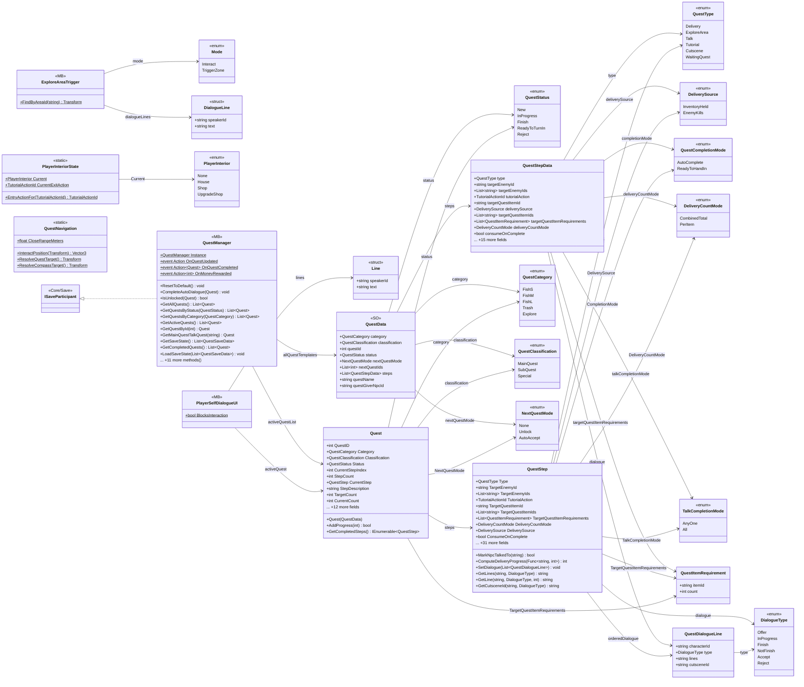
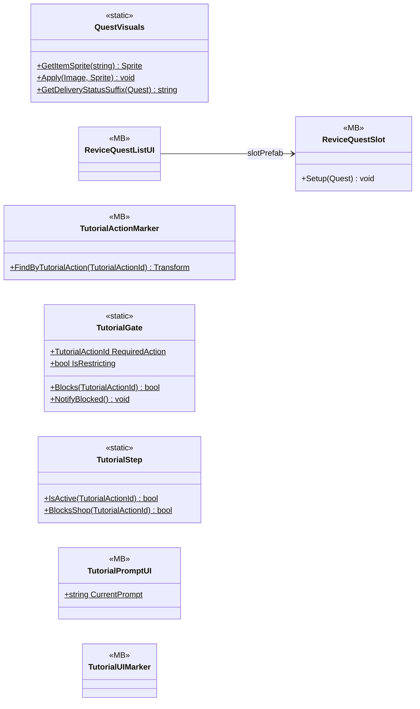

# Gameplay/QuestSystems/Quest

33 types · 1709 LOC (non-blank) · depends on: [Core/Events](Core_Events.md) ×23, [Core](Core.md) ×9, [Gameplay/Game](Gameplay_Game.md) ×4, [Gameplay/Cutscenes](Gameplay_Cutscenes.md) ×3, [Gameplay/Inventory](Gameplay_Inventory.md) ×3, [Core/Save](Core_Save.md) ×3, [Gameplay/Environments](Gameplay_Environments.md) ×3, [Gameplay/Contracts](Gameplay_Contracts.md) ×2, [Core/Scenes](Core_Scenes.md) ×2, [Gameplay/Entities/Players](Gameplay_Entities_Players.md) ×2, [Gameplay/Interaction](Gameplay_Interaction.md) ×1, [Core/Inputs](Core_Inputs.md) ×1, [Core/Save/DayReset](Core_Save_DayReset.md) ×1, [Gameplay/Services](Gameplay_Services.md) ×1, [Core/Datas/Items](Core_Datas_Items.md) ×1

[← index](../README.md)

## part 1

## part 2

## Event subscriptions

| Subscriber | Publisher | Event |
|---|---|---|
| ExploreAreaTrigger | QuestManager | OnQuestUpdated |
| PlayerInteriorState | TutorialEvents | OnActionPerformed |
| PlayerSelfDialogueUI | InputReader | OnInteracted |
| PlayerSelfDialogueUI | LoadingManager | OnLoadingFinished |
| PlayerSelfDialogueUI | QuestManager | OnQuestUpdated |
| QuestManager | CutsceneEvents | OnCutsceneFinished |
| QuestManager | DayManager | OnDayAdvanced |
| QuestManager | DayManager | OnDivedToday |
| QuestManager | DialogueState | OnChanged |
| QuestManager | EnemyEvents | OnEnemyKilled |
| QuestManager | ExploreEvents | OnAreaReached |
| QuestManager | NpcEvents | OnNpcTalkedTo |
| QuestManager | PlayerMoney | OnMoneyChanged |
| QuestManager | TutorialEvents | OnActionPerformed |
| ReviceQuestListUI | QuestManager | OnQuestUpdated |
| TutorialActionMarker | QuestManager | OnQuestUpdated |
| TutorialPromptUI | LoadingManager | OnLoadingFinished |
| TutorialPromptUI | PlayerUIState | OnLockChanged |
| TutorialPromptUI | QuestManager | OnQuestUpdated |
| TutorialUIMarker | QuestManager | OnQuestUpdated |

## Files

| Type | Kind | File | LOC |
|---|---|---|---|
| DeliveryCountMode | enum | `QuestData.cs:54` | 5 |
| DeliverySource | enum | `Quest.cs:28` | 5 |
| DialogueLine | struct | `ExploreAreaTrigger.cs:50` | 1 |
| DialogueType | enum | `QuestData.cs:40` | 9 |
| ExploreAreaTrigger | MB | `ExploreAreaTrigger.cs:23` | 171 |
| Line | struct | `PlayerSelfDialogueUI.cs:40` | 1 |
| Mode | enum | `ExploreAreaTrigger.cs:24` | 5 |
| NextQuestMode | enum | `QuestData.cs:32` | 6 |
| PlayerInterior | enum | `PlayerInteriorState.cs:5` | 1 |
| PlayerInteriorState | static | `PlayerInteriorState.cs:13` | 36 |
| PlayerSelfDialogueUI | MB | `PlayerSelfDialogueUI.cs:21` | 128 |
| Quest | class | `Quest.cs:292` | 163 |
| QuestCategory | enum | `QuestData.cs:14` | 8 |
| QuestClassification | enum | `QuestData.cs:24` | 6 |
| QuestCompletionMode | enum | `QuestData.cs:7` | 5 |
| QuestData | SO | `QuestData.cs:178` | 19 |
| QuestDialogueLine | class | `QuestData.cs:89` | 10 |
| QuestItemRequirement | class | `QuestData.cs:75` | 7 |
| QuestManager | MB | `QuestManager.cs:8` | 585 |
| QuestNavigation | static | `QuestNavigation.cs:9` | 39 |
| QuestStatus | enum | `Quest.cs:34` | 8 |
| QuestStep | class | `Quest.cs:48` | 117 |
| QuestStepData | class | `QuestData.cs:108` | 47 |
| QuestType | enum | `Quest.cs:8` | 9 |
| QuestVisuals | static | `QuestVisuals.cs:11` | 53 |
| ReviceQuestListUI | MB | `ReviceQuestListUI.cs:14` | 52 |
| ReviceQuestSlot | MB | `ReviceQuestSlot.cs:8` | 28 |
| TalkCompletionMode | enum | `QuestData.cs:65` | 5 |
| TutorialActionMarker | MB | `TutorialActionMarker.cs:14` | 42 |
| TutorialGate | static | `TutorialGate.cs:11` | 21 |
| TutorialPromptUI | MB | `TutorialPromptUI.cs:23` | 78 |
| TutorialStep | static | `TutorialGate.cs:58` | 24 |
| TutorialUIMarker | MB | `TutorialUIMarker.cs:15` | 22 |
