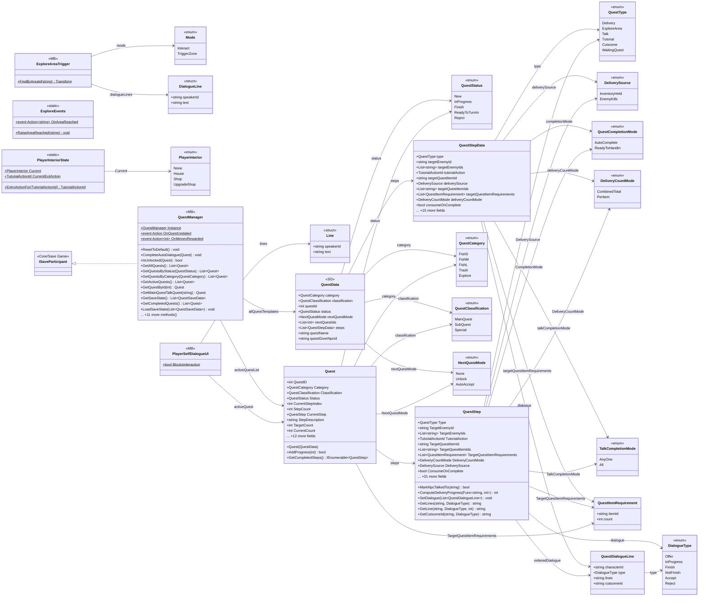
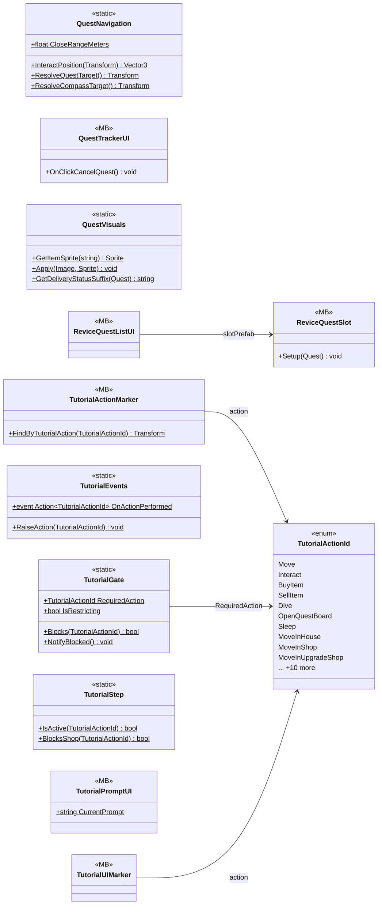

# Gameplay/QuestSystems/Quest

37 types · 1829 LOC (non-blank) · depends on: [Core](Core.md) ×13, [Gameplay/Cutscenes](Gameplay_Cutscenes.md) ×9, [UI](UI.md) ×7, [Gameplay/Environments](Gameplay_Environments.md) ×4, [UI/LoadingSecne](UI_LoadingSecne.md) ×3, [Core/Save Game](Core_Save_Game.md) ×3, [UI/Notifications](UI_Notifications.md) ×3, [UI/Inventory](UI_Inventory.md) ×3, [Gameplay/Entitys/Players](Gameplay_Entitys_Players.md) ×2, [UI/Interactions](UI_Interactions.md) ×1, [Core/Inputs](Core_Inputs.md) ×1, [Core/Services](Core_Services.md) ×1, [UI/QuestCompleteUI](UI_QuestCompleteUI.md) ×1, [Core/Save Game/DayAndResetEnemys](Core_Save_Game_DayAndResetEnemys.md) ×1, [Gameplay/Entitys/Enemys](Gameplay_Entitys_Enemys.md) ×1, [Gameplay/Entitys/NPCs](Gameplay_Entitys_NPCs.md) ×1, [UI/Items](UI_Items.md) ×1

[← index](../README.md)

## part 1

## part 2

## Event subscriptions

| Subscriber | Publisher | Event |
|---|---|---|
| ExploreAreaTrigger | QuestManager | OnQuestUpdated |
| PlayerInteriorState | TutorialEvents | OnActionPerformed |
| PlayerSelfDialogueUI | InputReader | OnInteracted |
| PlayerSelfDialogueUI | LoadingManager | OnLoadingFinished |
| PlayerSelfDialogueUI | QuestManager | OnQuestUpdated |
| QuestManager | CutsceneEvents | OnCutsceneFinished |
| QuestManager | DayManager | OnDayAdvanced |
| QuestManager | DayManager | OnDivedToday |
| QuestManager | EnemyEvents | OnEnemyKilled |
| QuestManager | ExploreEvents | OnAreaReached |
| QuestManager | NpcEvents | OnNpcTalkedTo |
| QuestManager | PlayerMoney | OnMoneyChanged |
| QuestManager | TutorialEvents | OnActionPerformed |
| QuestTrackerUI | QuestManager | OnQuestUpdated |
| ReviceQuestListUI | QuestManager | OnQuestUpdated |
| TutorialActionMarker | QuestManager | OnQuestUpdated |
| TutorialPromptUI | LoadingManager | OnLoadingFinished |
| TutorialPromptUI | PlayerUIState | OnLockChanged |
| TutorialPromptUI | QuestManager | OnQuestUpdated |
| TutorialUIMarker | QuestManager | OnQuestUpdated |

## Files

| Type | Kind | File | LOC |
|---|---|---|---|
| DeliveryCountMode | enum | `QuestData.cs:53` | 5 |
| DeliverySource | enum | `Quest.cs:27` | 5 |
| DialogueLine | struct | `ExploreAreaTrigger.cs:44` | 1 |
| DialogueType | enum | `QuestData.cs:39` | 9 |
| ExploreAreaTrigger | MB | `ExploreAreaTrigger.cs:24` | 167 |
| ExploreEvents | static | `ExploreEvents.cs:5` | 8 |
| Line | struct | `PlayerSelfDialogueUI.cs:34` | 1 |
| Mode | enum | `ExploreAreaTrigger.cs:25` | 5 |
| NextQuestMode | enum | `QuestData.cs:31` | 6 |
| PlayerInterior | enum | `PlayerInteriorState.cs:3` | 1 |
| PlayerInteriorState | static | `PlayerInteriorState.cs:11` | 36 |
| PlayerSelfDialogueUI | MB | `PlayerSelfDialogueUI.cs:23` | 125 |
| Quest | class | `Quest.cs:291` | 163 |
| QuestCategory | enum | `QuestData.cs:13` | 8 |
| QuestClassification | enum | `QuestData.cs:23` | 6 |
| QuestCompletionMode | enum | `QuestData.cs:6` | 5 |
| QuestData | SO | `QuestData.cs:177` | 19 |
| QuestDialogueLine | class | `QuestData.cs:88` | 10 |
| QuestItemRequirement | class | `QuestData.cs:74` | 7 |
| QuestManager | MB | `QuestManager.cs:7` | 588 |
| QuestNavigation | static | `QuestNavigation.cs:8` | 39 |
| QuestStatus | enum | `Quest.cs:33` | 8 |
| QuestStep | class | `Quest.cs:47` | 117 |
| QuestStepData | class | `QuestData.cs:107` | 47 |
| QuestTrackerUI | MB | `QuestTrackerUI.cs:7` | 85 |
| QuestType | enum | `Quest.cs:7` | 9 |
| QuestVisuals | static | `QuestVisuals.cs:10` | 53 |
| ReviceQuestListUI | MB | `ReviceQuestListUI.cs:13` | 52 |
| ReviceQuestSlot | MB | `ReviceQuestSlot.cs:7` | 28 |
| TalkCompletionMode | enum | `QuestData.cs:64` | 5 |
| TutorialActionId | enum | `TutorialEvents.cs:6` | 23 |
| TutorialActionMarker | MB | `TutorialActionMarker.cs:13` | 42 |
| TutorialEvents | static | `TutorialEvents.cs:36` | 8 |
| TutorialGate | static | `TutorialEvents.cs:56` | 21 |
| TutorialPromptUI | MB | `TutorialPromptUI.cs:22` | 78 |
| TutorialStep | static | `TutorialEvents.cs:103` | 24 |
| TutorialUIMarker | MB | `TutorialUIMarker.cs:14` | 22 |
