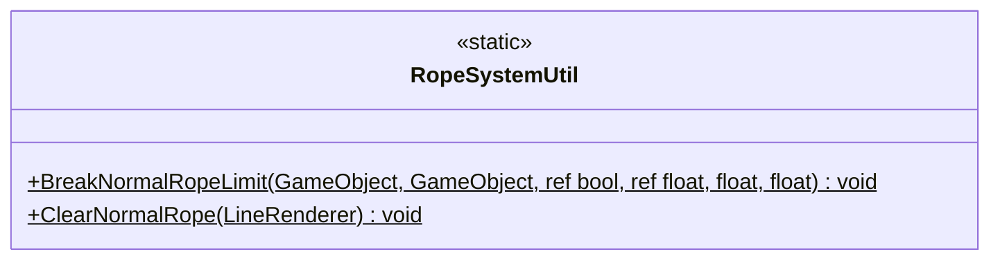

# Gameplay/RopeSystems

1 types · 49 LOC (non-blank) · depends on: none

[← index](../README.md)

## Files

| Type | Kind | File | LOC |
|---|---|---|---|
| RopeSystemUtil | static | `RopeSystemUtil.cs:8` | 49 |
