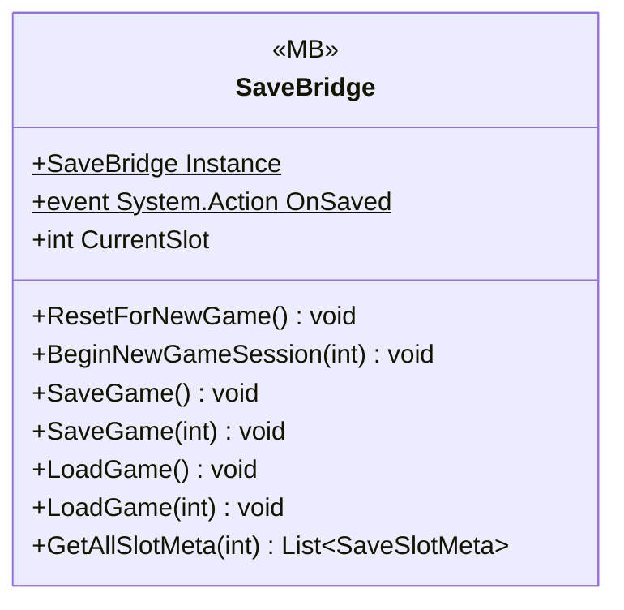

# Gameplay/Save

1 types · 192 LOC (non-blank) · depends on: [Core/Save](Core_Save.md) ×5, [Core/Save/DayReset](Core_Save_DayReset.md) ×3, [Core/Scenes](Core_Scenes.md) ×3, [Gameplay/Entities/Players](Gameplay_Entities_Players.md) ×3, [Core](Core.md) ×2, [Gameplay/Services](Gameplay_Services.md) ×2, [Gameplay/Cutscenes](Gameplay_Cutscenes.md) ×1, [Gameplay/Game](Gameplay_Game.md) ×1, [Gameplay/Inventory](Gameplay_Inventory.md) ×1, [Gameplay/QuestSystems/Quest](Gameplay_QuestSystems_Quest.md) ×1

[← index](../README.md)

## Event subscriptions

| Subscriber | Publisher | Event |
|---|---|---|
| SaveBridge | DayManager | OnDayAdvanced |

## Files

| Type | Kind | File | LOC |
|---|---|---|---|
| SaveBridge | MB | `SaveBridge.cs:9` | 192 |
