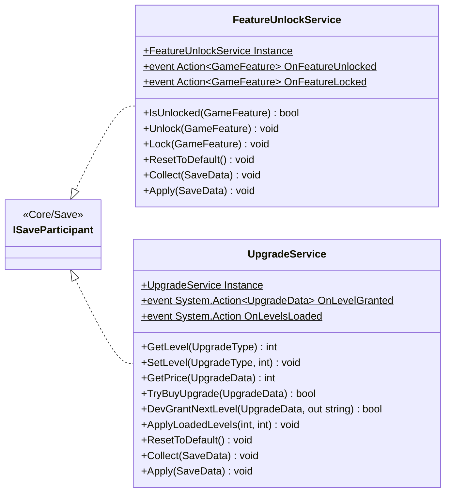

# Gameplay/Services

2 types · 146 LOC (non-blank) · depends on: [Core/Save](Core_Save.md) ×4, [Core/Events](Core_Events.md) ×3, [Gameplay/Entities/Players](Gameplay_Entities_Players.md) ×2, [Core/Datas/Upgrades](Core_Datas_Upgrades.md) ×2, [Core](Core.md) ×1, [Gameplay/QuestSystems/Quest](Gameplay_QuestSystems_Quest.md) ×1, [Gameplay/Entities/Players/OxygenTube](Gameplay_Entities_Players_OxygenTube.md) ×1, [Gameplay/Inventory](Gameplay_Inventory.md) ×1

[← index](../README.md)

## Files

| Type | Kind | File | LOC |
|---|---|---|---|
| FeatureUnlockService | class | `FeatureUnlockService.cs:17` | 66 |
| UpgradeService | class | `UpgradeService.cs:13` | 80 |
