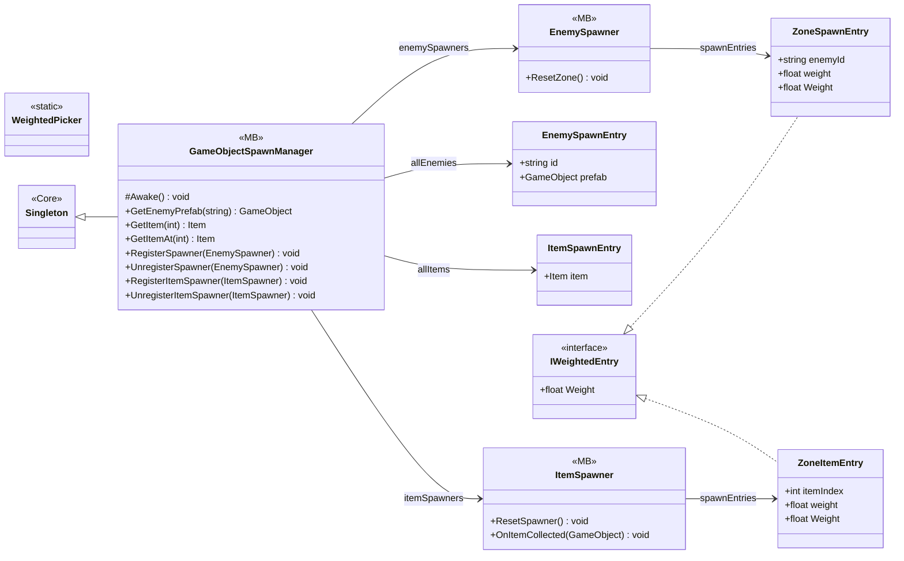

# Gameplay/Spawning

9 types · 477 LOC (non-blank) · depends on: [Core](Core.md) ×4, [Core/Pool](Core_Pool.md) ×3, [Core/Save/DayReset](Core_Save_DayReset.md) ×3, [Core/Datas/Items](Core_Datas_Items.md) ×2, [Gameplay/Services](Gameplay_Services.md) ×2, [Gameplay/Entities/Enemies/Behaviours](Gameplay_Entities_Enemies_Behaviours.md) ×1, [Gameplay/Entities/Enemies/NavAgents](Gameplay_Entities_Enemies_NavAgents.md) ×1, [Gameplay/Entities/Enemies/NavAgents/Core](Gameplay_Entities_Enemies_NavAgents_Core.md) ×1, [Gameplay/Entities/Players](Gameplay_Entities_Players.md) ×1, [Gameplay/Items/Pickups](Gameplay_Items_Pickups.md) ×1

[← index](../README.md)

## Event subscriptions

| Subscriber | Publisher | Event |
|---|---|---|
| GameObjectSpawnManager | DayManager | OnDayAdvanced |
| GameObjectSpawnManager | DayManager | OnEnemyReset |
| ItemSpawner | FeatureUnlockService | OnFeatureUnlocked |

## Files

| Type | Kind | File | LOC |
|---|---|---|---|
| EnemySpawnEntry | class | `GameObjectSpawnManager.cs:11` | 6 |
| EnemySpawner | MB | `EnemySpawner.cs:24` | 194 |
| GameObjectSpawnManager | MB | `GameObjectSpawnManager.cs:27` | 111 |
| IWeightedEntry | interface | `WeightedPicker.cs:6` | 4 |
| ItemSpawnEntry | class | `GameObjectSpawnManager.cs:19` | 5 |
| ItemSpawner | MB | `ItemSpawner.cs:23` | 117 |
| WeightedPicker | static | `WeightedPicker.cs:12` | 24 |
| ZoneItemEntry | class | `ItemSpawner.cs:9` | 8 |
| ZoneSpawnEntry | class | `EnemySpawner.cs:11` | 8 |
