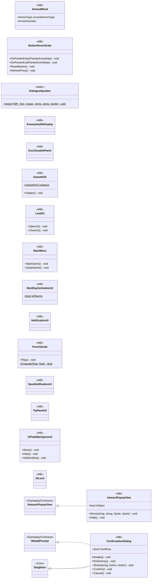

# UI

17 types · 752 LOC (non-blank) · depends on: [Core](Core.md) ×12, [Core/Events](Core_Events.md) ×5, [Core/Save/DayReset](Core_Save_DayReset.md) ×3, [Gameplay/Contracts](Gameplay_Contracts.md) ×3, [Gameplay/Save](Gameplay_Save.md) ×3, [Core/Inputs](Core_Inputs.md) ×2, [Gameplay/Entities/Players](Gameplay_Entities_Players.md) ×2, [Gameplay/Game](Gameplay_Game.md) ×2, [Gameplay/Services](Gameplay_Services.md) ×2, [UI/UIManager](UI_UIManager.md) ×2, [Core/Datas](Core_Datas.md) ×1, [Core/Scenes](Core_Scenes.md) ×1, [Gameplay/Cutscenes](Gameplay_Cutscenes.md) ×1, [Gameplay/Entities/Enemies](Gameplay_Entities_Enemies.md) ×1, [Gameplay/Entities/Players/OxygenTube](Gameplay_Entities_Players_OxygenTube.md) ×1, [Gameplay/Environments](Gameplay_Environments.md) ×1, [Gameplay/QuestSystems/Quest](Gameplay_QuestSystems_Quest.md) ×1, [UI/Inventory](UI_Inventory.md) ×1, [UI/UIMenuSetting](UI_UIMenuSetting.md) ×1, [UI/Upgrades](UI_Upgrades.md) ×1

[← index](../README.md)

## Event subscriptions

| Subscriber | Publisher | Event |
|---|---|---|
| AmmoWheel | InputReader | OnAmmoSelected |
| GameHUD | DayManager | OnDayAdvanced |
| GameHUD | InputReader | OnMenuToggled |
| GameHUD | PlayerUIState | OnLockChanged |
| LandUI | DayManager | OnDayAdvanced |
| LandUI | DayManager | OnDivedToday |
| LandUI | DialogueState | OnChanged |
| LandUI | FeatureUnlockService | OnFeatureUnlocked |
| LandUI | LoadingManager | OnLoadingFinished |
| NextDayAnimationUI | DayManager | OnDayAdvanced |
| SaveNotificationUI | SaveBridge | OnSaved |

## Files

| Type | Kind | File | LOC |
|---|---|---|---|
| AmmoWheel | MB | `AmmoWheel.cs:7` | 50 |
| ButtonHoverScale | MB | `ButtonHoverScale.cs:9` | 59 |
| ConfirmationDialog | MB | `ConfirmationDialog.cs:12` | 59 |
| DialogueSpeaker | static | `DialogueSpeaker.cs:15` | 18 |
| EnemyHealthDisplay | MB | `EnemyHealthDisplay.cs:8` | 9 |
| EscClosablePanel | MB | `EscClosablePanel.cs:13` | 11 |
| GameHUD | MB | `GameHUD.cs:12` | 186 |
| InteractPopupView | MB | `InteractPopupView.cs:9` | 29 |
| LandUI | MB | `LandUI.cs:12` | 142 |
| MainMenu | MB | `MainMenu.cs:8` | 11 |
| NextDayAnimationUI | MB | `NextDayAnimationUI.cs:10` | 48 |
| NotificationUI | MB | `NotificationUI.cs:8` | 12 |
| PunchScale | MB | `PunchScale.cs:9` | 30 |
| SaveNotificationUI | MB | `SaveNotificationUI.cs:8` | 7 |
| TipPanelUI | MB | `TipPanelUI.cs:8` | 34 |
| UIFadeBackground | MB | `UIFadeBackground.cs:7` | 40 |
| UILock | MB | `UILock.cs:7` | 7 |
