# UI

17 types · 732 LOC (non-blank) · depends on: [Core](Core.md) ×12, [Core/Save Game](Core_Save_Game.md) ×3, [Gameplay/QuestSystems/Quest](Gameplay_QuestSystems_Quest.md) ×3, [Core/Save Game/DayAndResetEnemys](Core_Save_Game_DayAndResetEnemys.md) ×3, [UI/Notifications](UI_Notifications.md) ×3, [Core/Inputs](Core_Inputs.md) ×2, [Core/Services](Core_Services.md) ×2, [Core/Datas](Core_Datas.md) ×1, [Gameplay/Entitys/Players](Gameplay_Entitys_Players.md) ×1, [UI/Upgrads](UI_Upgrads.md) ×1, [Gameplay/Environments](Gameplay_Environments.md) ×1, [Gameplay/Entitys/Enemys](Gameplay_Entitys_Enemys.md) ×1, [UI/UIManager](UI_UIManager.md) ×1, [UI/UIMenuSetting](UI_UIMenuSetting.md) ×1, [Gameplay/Cutscenes](Gameplay_Cutscenes.md) ×1, [Gameplay/Entitys/Players/OxygenTube](Gameplay_Entitys_Players_OxygenTube.md) ×1, [UI/LoadingSecne](UI_LoadingSecne.md) ×1, [UI/Inventory](UI_Inventory.md) ×1

[← index](../README.md)

```mermaid
classDiagram
  direction LR
  class AmmoWheel {
    <<MB>>
    +AmmoType currentAmmoType
    +int AmmoIndex
  }
  class ButtonHoverScale {
    <<MB>>
    +OnPointerEnter(PointerEventData) void
    +OnPointerExit(PointerEventData) void
    +ResetButton() void
    +RefreshPrice() void
  }
  class ConfirmationDialog {
    <<MB>>
    +ConfirmationDialog Instance$
    +Show(string, Action, Action) void
    +Confirm() void
    +Cancel() void
  }
  class DialogueSpeaker {
    <<static>>
    +Apply(TMP_Text, Image, string, string, Sprite)$ void
  }
  class EnemyHealthDisplay {
    <<MB>>
  }
  class EscClosablePanel {
    <<MB>>
  }
  class GameHUD {
    <<MB>>
    +GameHUD instance$
    +FadeIn() void
  }
  class LandUI {
    <<MB>>
    +OpenUI() void
    +CloseUI() void
  }
  class MainMenu {
    <<MB>>
    +StartGame() void
    +QuiteGame() void
  }
  class NextDayAnimationUI {
    <<MB>>
    +bool IsPlaying$
  }
  class NotificationManager {
    <<static>>
    +event Action~NotificationMessage~ OnNotify$
    +event Action~NotificationChannel~ OnClear$
    +Notify(string, NotificationChannel, Sprite, bool)$ void
    +Clear(NotificationChannel)$ void
  }
  class NotificationUI {
    <<MB>>
  }
  class PunchScale {
    <<MB>>
    +Play() void
    +Evaluate(float, float)$ float
  }
  class SaveNotificationUI {
    <<MB>>
  }
  class TipPanelUI {
    <<MB>>
  }
  class UIFadeBackground {
    <<MB>>
    +Show() void
    +Hide() void
    +SetDim(float) void
  }
  class UILock {
    <<MB>>
  }
```

## Event subscriptions

| Subscriber | Publisher | Event |
|---|---|---|
| AmmoWheel | InputReader | OnAmmoSelected |
| GameHUD | DayManager | OnDayAdvanced |
| GameHUD | InputReader | OnMenuToggled |
| GameHUD | PlayerUIState | OnLockChanged |
| LandUI | DayManager | OnDayAdvanced |
| LandUI | DayManager | OnDivedToday |
| LandUI | DialogueState | OnChanged |
| LandUI | FeatureUnlockService | OnFeatureUnlocked |
| LandUI | LoadingManager | OnLoadingFinished |
| NextDayAnimationUI | DayManager | OnDayAdvanced |
| SaveNotificationUI | SaveBridge | OnSaved |

## Files

| Type | Kind | File | LOC |
|---|---|---|---|
| AmmoWheel | MB | `AmmoWheel.cs:5` | 50 |
| ButtonHoverScale | MB | `ButtonHoverScale.cs:6` | 59 |
| ConfirmationDialog | MB | `ConfirmationDialog.cs:10` | 56 |
| DialogueSpeaker | static | `DialogueSpeaker.cs:13` | 18 |
| EnemyHealthDisplay | MB | `EnemyHealthDisplay.cs:6` | 9 |
| EscClosablePanel | MB | `EscClosablePanel.cs:11` | 11 |
| GameHUD | MB | `GameHUD.cs:11` | 186 |
| LandUI | MB | `LandUI.cs:10` | 142 |
| MainMenu | MB | `MainMenu.cs:6` | 11 |
| NextDayAnimationUI | MB | `NextDayAnimationUI.cs:8` | 48 |
| NotificationManager | static | `NotificationManager.cs:7` | 12 |
| NotificationUI | MB | `NotificationUI.cs:6` | 12 |
| PunchScale | MB | `PunchScale.cs:7` | 30 |
| SaveNotificationUI | MB | `SaveNotificationUI.cs:6` | 7 |
| TipPanelUI | MB | `TipPanelUI.cs:6` | 34 |
| UIFadeBackground | MB | `UIFadeBackground.cs:5` | 40 |
| UILock | MB | `UILock.cs:5` | 7 |
