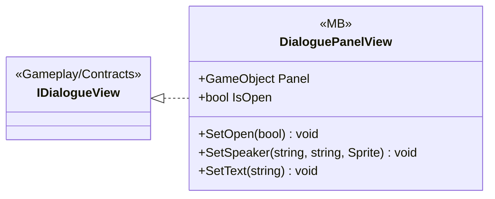

# UI/Dialogue

1 types · 19 LOC (non-blank) · depends on: [UI](UI.md) ×1, [Gameplay/Contracts](Gameplay_Contracts.md) ×1

[← index](../README.md)

## Files

| Type | Kind | File | LOC |
|---|---|---|---|
| DialoguePanelView | MB | `DialoguePanelView.cs:8` | 19 |
