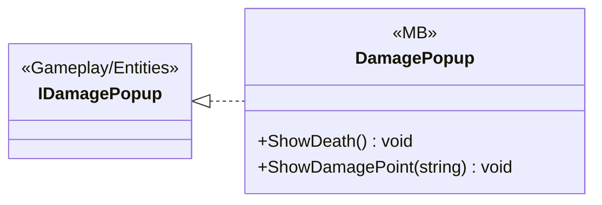

# UI/Interactions

1 types · 26 LOC (non-blank) · depends on: [Gameplay/Entities](Gameplay_Entities.md) ×1

[← index](../README.md)

## Files

| Type | Kind | File | LOC |
|---|---|---|---|
| DamagePopup | MB | `DamagePopup.cs:9` | 26 |
