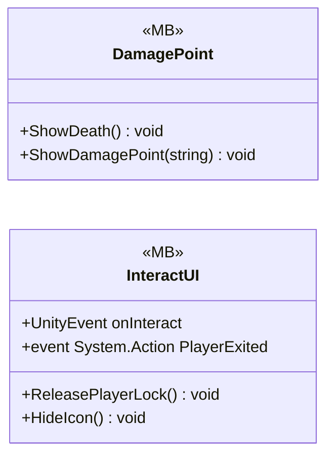

# UI/Interactions

2 types · 116 LOC (non-blank) · depends on: [Core/Events](Core_Events.md) ×3, [Core](Core.md) ×3, [Gameplay/QuestSystems/Quest](Gameplay_QuestSystems_Quest.md) ×2, [Core/Inputs](Core_Inputs.md) ×1, [UI/Loading](UI_Loading.md) ×1, [Core/Services](Core_Services.md) ×1, [Gameplay/Cutscenes](Gameplay_Cutscenes.md) ×1

[← index](../README.md)

## Event subscriptions

| Subscriber | Publisher | Event |
|---|---|---|
| InteractUI | InputReader | OnInteracted |

## Files

| Type | Kind | File | LOC |
|---|---|---|---|
| DamagePoint | MB | `DamagePoint.cs:7` | 26 |
| InteractUI | MB | `InteractUI.cs:20` | 90 |
