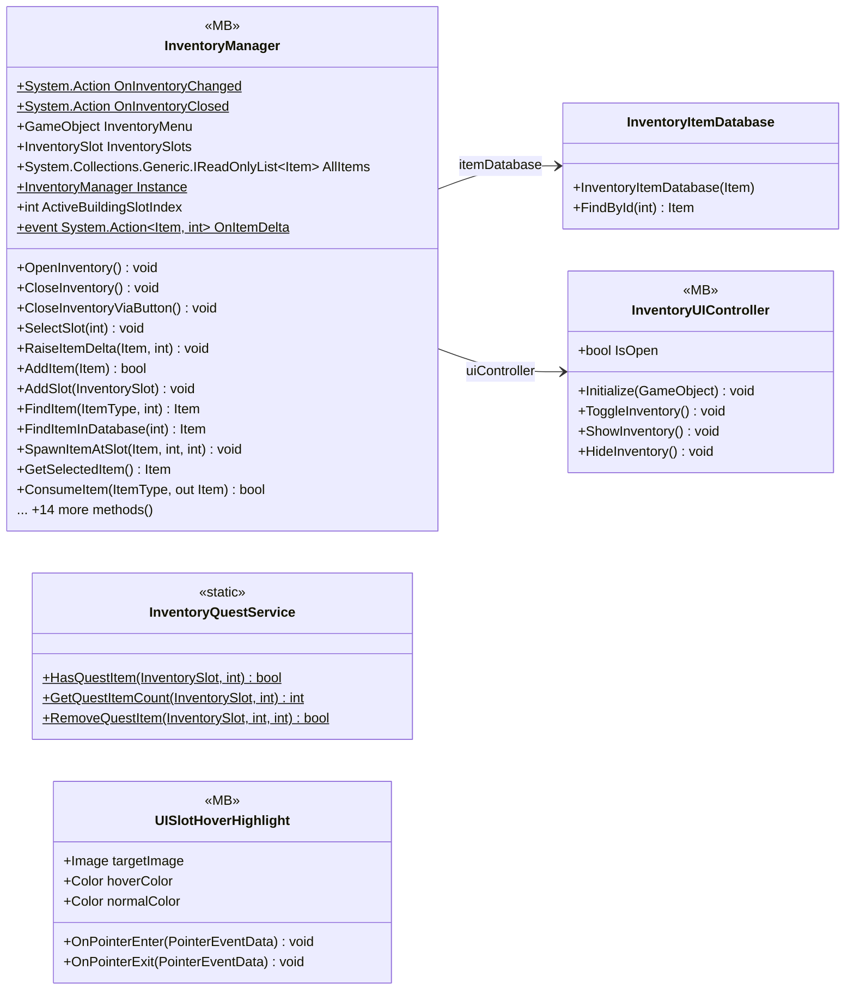

# UI/Inventory

5 types · 584 LOC (non-blank) · depends on: [UI/Inventory/InventoryPlayer](UI_Inventory_InventoryPlayer.md) ×4, [UI/Items](UI_Items.md) ×3, [Core](Core.md) ×3, [Gameplay/QuestSystems/Quest](Gameplay_QuestSystems_Quest.md) ×2, [UI](UI.md) ×2, [Gameplay/AudioSetting](Gameplay_AudioSetting.md) ×2, [Core/Save Game/DayAndResetEnemys](Core_Save_Game_DayAndResetEnemys.md) ×1, [Gameplay/InteractObjects](Gameplay_InteractObjects.md) ×1, [Core/Services](Core_Services.md) ×1, [Core/Inputs](Core_Inputs.md) ×1, [UI/UIManager](UI_UIManager.md) ×1

[← index](../README.md)

## Event subscriptions

| Subscriber | Publisher | Event |
|---|---|---|
| InventoryManager | InputReader | OnInventoryToggled |

## Files

| Type | Kind | File | LOC |
|---|---|---|---|
| InventoryItemDatabase | class | `InventoryItemDatabase.cs:3` | 18 |
| InventoryManager | MB | `InventoryManager.cs:8` | 437 |
| InventoryQuestService | static | `InventoryQuestService.cs:5` | 51 |
| InventoryUIController | MB | `InventoryUIController.cs:5` | 57 |
| UISlotHoverHighlight | MB | `UISlotHoverHighlight.cs:7` | 21 |
