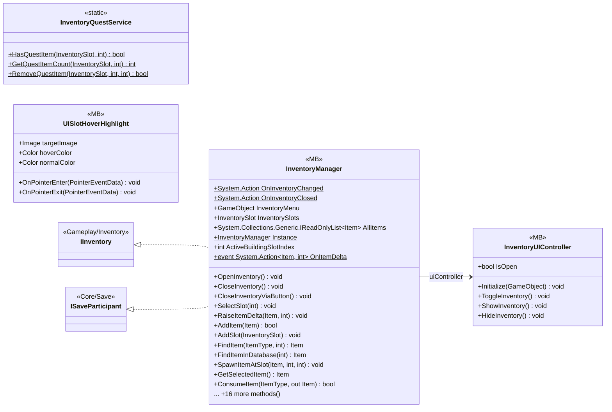

# UI/Inventory

4 types · 666 LOC (non-blank) · depends on: [UI/Inventory/InventoryPlayer](UI_Inventory_InventoryPlayer.md) ×4, [Core/Save](Core_Save.md) ×3, [Core/Datas/Items](Core_Datas_Items.md) ×3, [Core/Events](Core_Events.md) ×3, [Gameplay/Inventory](Gameplay_Inventory.md) ×2, [Core/Datas/Upgrades](Core_Datas_Upgrades.md) ×2, [Core](Core.md) ×2, [Gameplay/Services](Gameplay_Services.md) ×2, [Gameplay/AudioSetting](Gameplay_AudioSetting.md) ×2, [Gameplay/InteractObjects](Gameplay_InteractObjects.md) ×1, [Gameplay/Game](Gameplay_Game.md) ×1, [UI](UI.md) ×1, [Gameplay/Spawning](Gameplay_Spawning.md) ×1, [Core/Inputs](Core_Inputs.md) ×1, [UI/UIManager](UI_UIManager.md) ×1

[← index](../README.md)

## Event subscriptions

| Subscriber | Publisher | Event |
|---|---|---|
| InventoryManager | InputReader | OnInventoryToggled |
| InventoryManager | UpgradeService | OnLevelGranted |
| InventoryManager | UpgradeService | OnLevelsLoaded |

## Files

| Type | Kind | File | LOC |
|---|---|---|---|
| InventoryManager | MB | `InventoryManager.cs:9` | 537 |
| InventoryQuestService | static | `InventoryQuestService.cs:7` | 51 |
| InventoryUIController | MB | `InventoryUIController.cs:7` | 57 |
| UISlotHoverHighlight | MB | `UISlotHoverHighlight.cs:9` | 21 |
