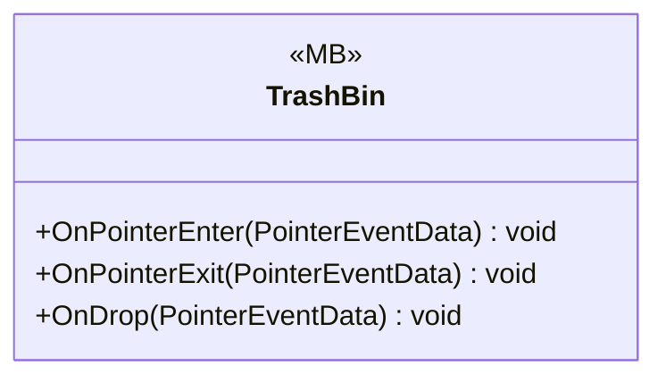

# UI/Inventory/InventoryBin

1 types · 56 LOC (non-blank) · depends on: [UI/Inventory](UI_Inventory.md) ×1, [UI/Inventory/InventoryPlayer](UI_Inventory_InventoryPlayer.md) ×1

[← index](../README.md)

## Files

| Type | Kind | File | LOC |
|---|---|---|---|
| TrashBin | MB | `TrashBin.cs:9` | 56 |
