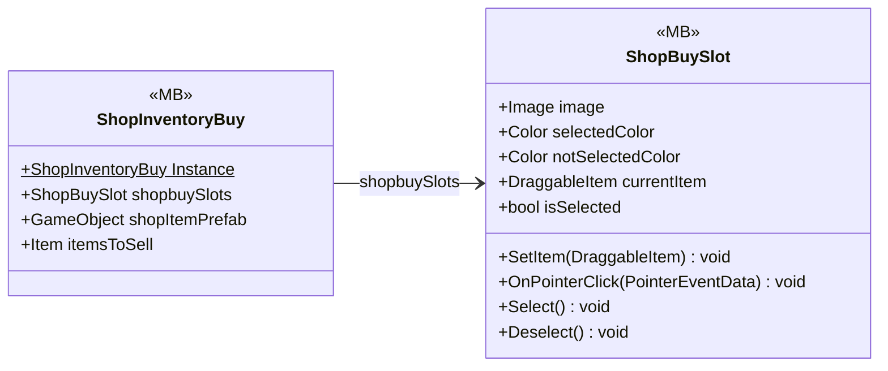

# UI/Inventory/InventoryBuy

2 types · 70 LOC (non-blank) · depends on: [UI/Inventory/InventoryPlayer](UI_Inventory_InventoryPlayer.md) ×2, [UI/Shop](UI_Shop.md) ×1, [Core/Datas/Items](Core_Datas_Items.md) ×1

[← index](../README.md)

## Files

| Type | Kind | File | LOC |
|---|---|---|---|
| ShopBuySlot | MB | `ShopBuySlot.cs:7` | 35 |
| ShopInventoryBuy | MB | `ShopInventoryBuy.cs:5` | 35 |
