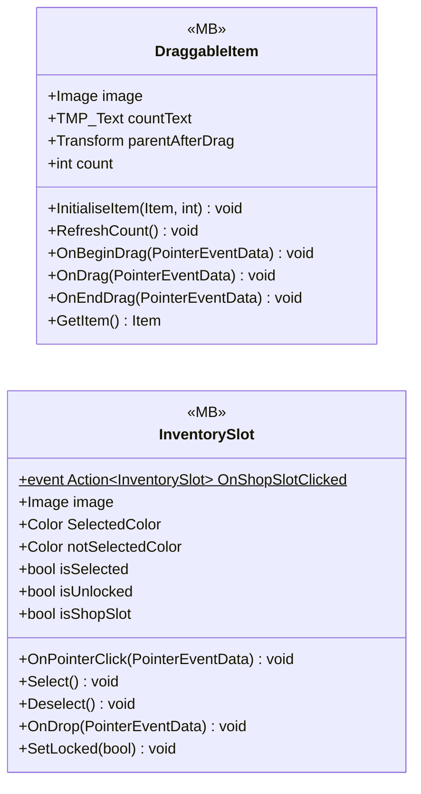

# UI/Inventory/InventoryPlayer

2 types · 105 LOC (non-blank) · depends on: [UI/Inventory](UI_Inventory.md) ×2, [UI/Items](UI_Items.md) ×1

[← index](../README.md)

## Files

| Type | Kind | File | LOC |
|---|---|---|---|
| DraggableItem | MB | `DraggableItem.cs:8` | 43 |
| InventorySlot | MB | `InventorySlot.cs:8` | 62 |
