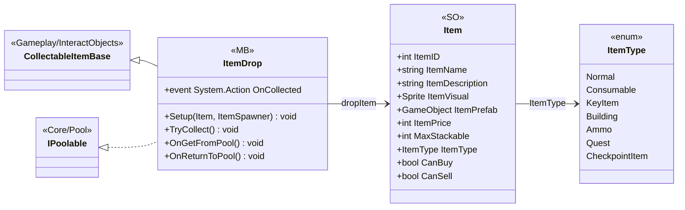

# UI/Items

3 types · 83 LOC (non-blank) · depends on: [Core/Pool](Core_Pool.md) ×2, [Gameplay/AudioSetting](Gameplay_AudioSetting.md) ×2, [Gameplay/QuestSystems/Quest](Gameplay_QuestSystems_Quest.md) ×1, [Gameplay/InteractObjects](Gameplay_InteractObjects.md) ×1, [Core/Save Game/DayAndResetEnemys](Core_Save_Game_DayAndResetEnemys.md) ×1, [UI/Inventory](UI_Inventory.md) ×1

[← index](../README.md)

## Files

| Type | Kind | File | LOC |
|---|---|---|---|
| Item | SO | `Item.cs:6` | 22 |
| ItemDrop | MB | `Itemdrop.cs:7` | 51 |
| ItemType | enum | `Item.cs:36` | 10 |
