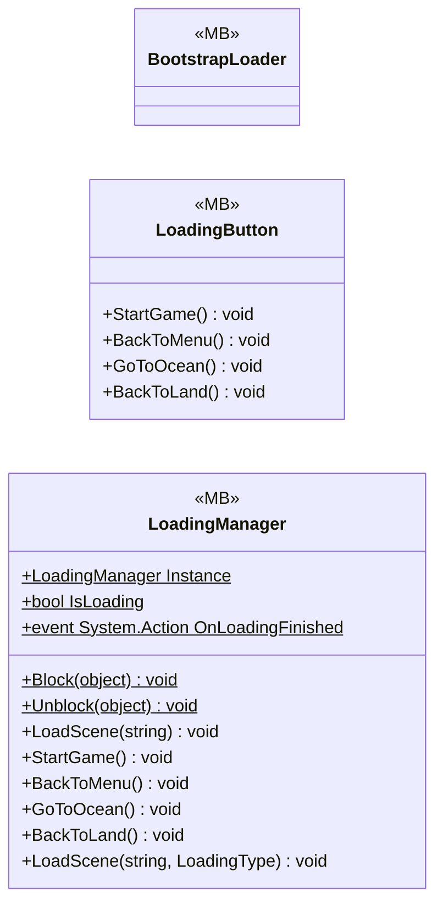

# UI/Loading

3 types · 189 LOC (non-blank) · depends on: [Core](Core.md) ×1, [UI/Loading/LoadingVisualController](UI_Loading_LoadingVisualController.md) ×1, [Core/Scenes](Core_Scenes.md) ×1

[← index](../README.md)

## Files

| Type | Kind | File | LOC |
|---|---|---|---|
| BootstrapLoader | MB | `BootstrapLoader.cs:6` | 7 |
| LoadingButton | MB | `LoadingButton.cs:5` | 39 |
| LoadingManager | MB | `LoadingManager.cs:9` | 143 |
