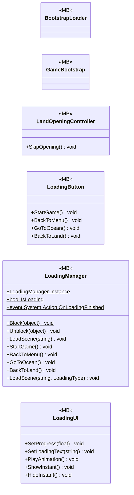

# UI/LoadingSecne

6 types · 280 LOC (non-blank) · depends on: [UI/LoadingSecne/LoadingVisualController](UI_LoadingSecne_LoadingVisualController.md) ×2, [Core](Core.md) ×1

[← index](../README.md)

## Files

| Type | Kind | File | LOC |
|---|---|---|---|
| BootstrapLoader | MB | `BootstrapLoader.cs:6` | 7 |
| GameBootstrap | MB | `GameBootstrap.cs:5` | 8 |
| LandOpeningController | MB | `LandOpeningController.cs:6` | 31 |
| LoadingButton | MB | `LoadingButton.cs:5` | 39 |
| LoadingManager | MB | `LoadingManager.cs:9` | 143 |
| LoadingUI | MB | `LoadingUI.cs:8` | 52 |
