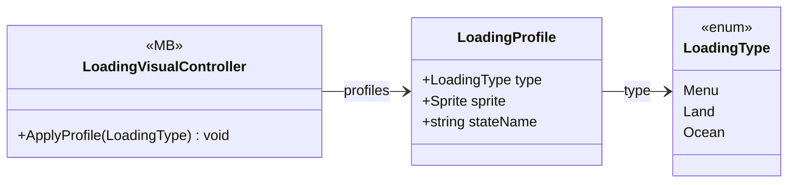

# UI/Loading/LoadingVisualController

3 types · 40 LOC (non-blank) · depends on: none

[← index](../README.md)

## Files

| Type | Kind | File | LOC |
|---|---|---|---|
| LoadingProfile | class | `LoadingVisualController.cs:15` | 7 |
| LoadingType | enum | `LoadingVisualController.cs:6` | 6 |
| LoadingVisualController | MB | `LoadingVisualController.cs:13` | 34 |
