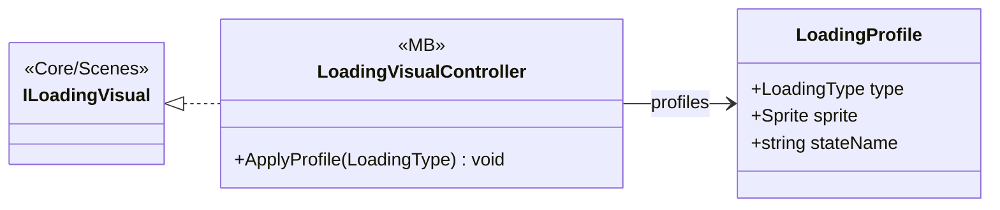

# UI/Loading/LoadingVisualController

2 types · 34 LOC (non-blank) · depends on: [Core/Scenes](Core_Scenes.md) ×3

[← index](../README.md)

## Files

| Type | Kind | File | LOC |
|---|---|---|---|
| LoadingProfile | class | `LoadingVisualController.cs:8` | 7 |
| LoadingVisualController | MB | `LoadingVisualController.cs:6` | 34 |
