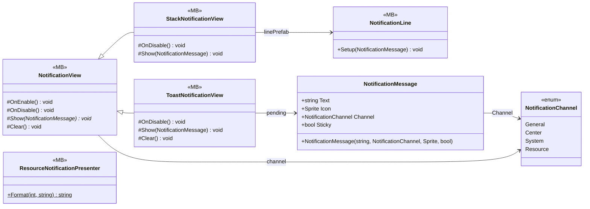

# UI/Notifications

7 types · 201 LOC (non-blank) · depends on: [UI](UI.md) ×2, [Gameplay/Entities/Players](Gameplay_Entities_Players.md) ×1, [UI/Inventory](UI_Inventory.md) ×1, [UI/Items](UI_Items.md) ×1

[← index](../README.md)

## Event subscriptions

| Subscriber | Publisher | Event |
|---|---|---|
| NotificationView | NotificationManager | OnClear |
| NotificationView | NotificationManager | OnNotify |
| ResourceNotificationPresenter | InventoryManager | OnItemDelta |
| ResourceNotificationPresenter | PlayerMoney | OnMoneyDelta |

## Files

| Type | Kind | File | LOC |
|---|---|---|---|
| NotificationChannel | enum | `NotificationChannel.cs:5` | 7 |
| NotificationLine | MB | `NotificationLine.cs:10` | 32 |
| NotificationMessage | class | `NotificationMessage.cs:6` | 14 |
| NotificationView | MB, abstract | `NotificationView.cs:6` | 26 |
| ResourceNotificationPresenter | MB | `ResourceNotificationPresenter.cs:6` | 25 |
| StackNotificationView | MB | `StackNotificationView.cs:6` | 22 |
| ToastNotificationView | MB | `ToastNotificationView.cs:9` | 75 |
