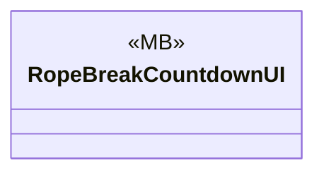

# UI/Ocean

1 types · 73 LOC (non-blank) · depends on: [Core](Core.md) ×1, [Gameplay/Entities/Players/OxygenTube](Gameplay_Entities_Players_OxygenTube.md) ×1, [Gameplay/Game](Gameplay_Game.md) ×1

[← index](../README.md)

## Event subscriptions

| Subscriber | Publisher | Event |
|---|---|---|
| RopeBreakCountdownUI | OxygenRope | OnRopeBreachEnd |
| RopeBreakCountdownUI | OxygenRope | OnRopeBreachStart |

## Files

| Type | Kind | File | LOC |
|---|---|---|---|
| RopeBreakCountdownUI | MB | `RopeBreakCountdownUI.cs:10` | 73 |
