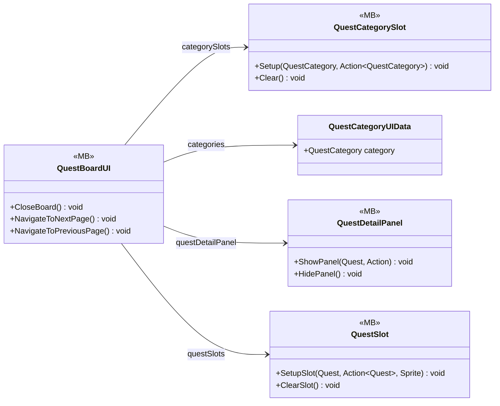

# UI/Quest

5 types · 408 LOC (non-blank) · depends on: [Gameplay/QuestSystems/Quest](Gameplay_QuestSystems_Quest.md) ×10, [Core/Events](Core_Events.md) ×4, [Core](Core.md) ×1, [Gameplay/Environments](Gameplay_Environments.md) ×1

[← index](../README.md)

## Event subscriptions

| Subscriber | Publisher | Event |
|---|---|---|
| QuestBoardUI | QuestManager | OnQuestUpdated |

## Files

| Type | Kind | File | LOC |
|---|---|---|---|
| QuestBoardUI | MB | `QuestBoardUI.cs:8` | 249 |
| QuestCategorySlot | MB | `QuestCategorySlot.cs:8` | 28 |
| QuestCategoryUIData | class | `QuestBoardUI.cs:53` | 4 |
| QuestDetailPanel | MB | `QuestDetailPanel.cs:8` | 70 |
| QuestSlot | MB | `QuestSlot.cs:9` | 61 |
