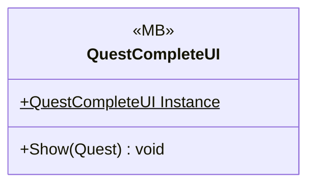

# UI/QuestCompleteUI

1 types · 98 LOC (non-blank) · depends on: [Gameplay/QuestSystems/Quest](Gameplay_QuestSystems_Quest.md) ×1, [UI](UI.md) ×1

[← index](../README.md)

## Files

| Type | Kind | File | LOC |
|---|---|---|---|
| QuestCompleteUI | MB | `QuestCompleteUI.cs:7` | 98 |
