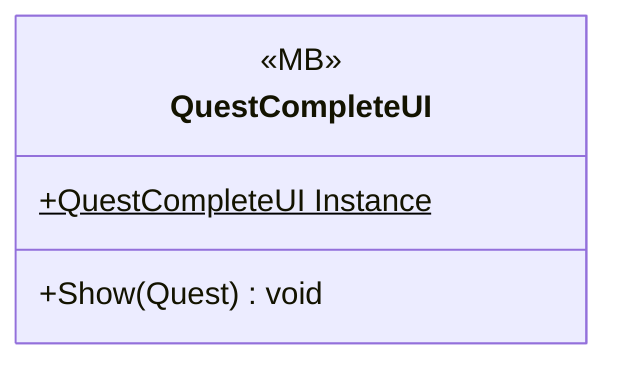

# UI/QuestCompleteUI

1 types · 104 LOC (non-blank) · depends on: [Gameplay/QuestSystems/Quest](Gameplay_QuestSystems_Quest.md) ×2, [UI](UI.md) ×1

[← index](../README.md)

## Event subscriptions

| Subscriber | Publisher | Event |
|---|---|---|
| QuestCompleteUI | QuestManager | OnQuestCompleted |

## Files

| Type | Kind | File | LOC |
|---|---|---|---|
| QuestCompleteUI | MB | `QuestCompleteUI.cs:9` | 104 |
