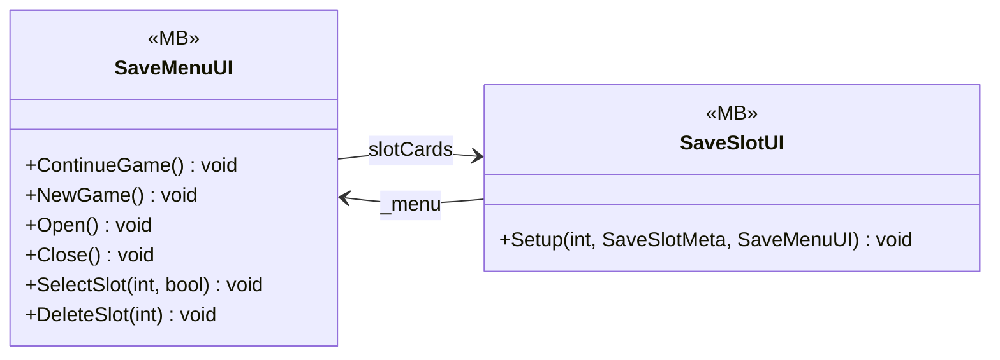

# UI/Save

2 types · 141 LOC (non-blank) · depends on: [Core/Save](Core_Save.md) ×2, [UI](UI.md) ×1, [Core/Scenes](Core_Scenes.md) ×1, [Core/Events](Core_Events.md) ×1, [Gameplay/Save](Gameplay_Save.md) ×1, [Core](Core.md) ×1

[← index](../README.md)

## Files

| Type | Kind | File | LOC |
|---|---|---|---|
| SaveMenuUI | MB | `SaveMenuUI.cs:8` | 102 |
| SaveSlotUI | MB | `SaveSlotUI.cs:14` | 39 |
