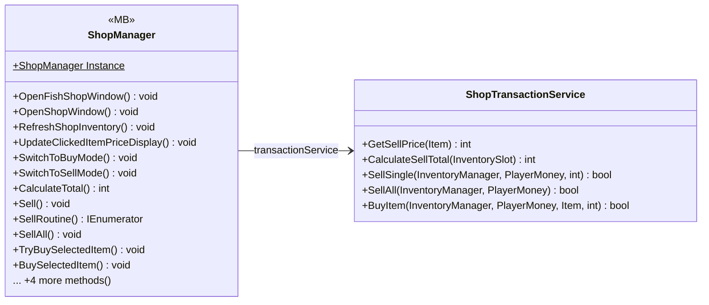

# UI/Shop

2 types · 403 LOC (non-blank) · depends on: [Gameplay/QuestSystems/Quest](Gameplay_QuestSystems_Quest.md) ×5, [UI/Inventory/InventoryPlayer](UI_Inventory_InventoryPlayer.md) ×4, [UI](UI.md) ×3, [UI/Items](UI_Items.md) ×3, [Gameplay/Entitys/Players](Gameplay_Entitys_Players.md) ×2, [UI/Inventory](UI_Inventory.md) ×2, [UI/Inventory/InventoryBuy](UI_Inventory_InventoryBuy.md) ×1, [Core](Core.md) ×1

[← index](../README.md)

## Event subscriptions

| Subscriber | Publisher | Event |
|---|---|---|
| ShopManager | InventorySlot | OnShopSlotClicked |
| ShopManager | QuestManager | OnQuestUpdated |

## Files

| Type | Kind | File | LOC |
|---|---|---|---|
| ShopManager | MB | `ShopManager.cs:8` | 299 |
| ShopTransactionService | class | `ShopTransactionService.cs:5` | 104 |
