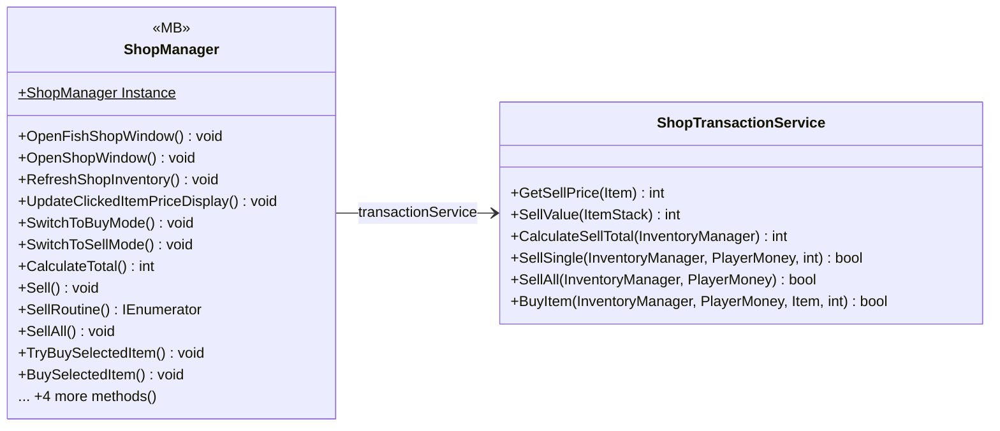

# UI/Shop

2 types · 366 LOC (non-blank) · depends on: [Core/Events](Core_Events.md) ×5, [Core/Datas/Items](Core_Datas_Items.md) ×3, [Gameplay/Entities/Players](Gameplay_Entities_Players.md) ×3, [UI/Inventory](UI_Inventory.md) ×3, [Gameplay/Inventory](Gameplay_Inventory.md) ×2, [Gameplay/QuestSystems/Quest](Gameplay_QuestSystems_Quest.md) ×2, [UI/Inventory/InventoryPlayer](UI_Inventory_InventoryPlayer.md) ×2, [UI](UI.md) ×1, [UI/Inventory/InventoryBuy](UI_Inventory_InventoryBuy.md) ×1

[← index](../README.md)

## Event subscriptions

| Subscriber | Publisher | Event |
|---|---|---|
| ShopManager | InventoryManager | OnInventoryChanged |
| ShopManager | InventoryManager | OnInventoryClosed |
| ShopManager | InventorySlot | OnShopSlotClicked |
| ShopManager | QuestManager | OnQuestUpdated |

## Files

| Type | Kind | File | LOC |
|---|---|---|---|
| ShopManager | MB | `ShopManager.cs:10` | 287 |
| ShopTransactionService | class | `ShopTransactionService.cs:7` | 79 |
