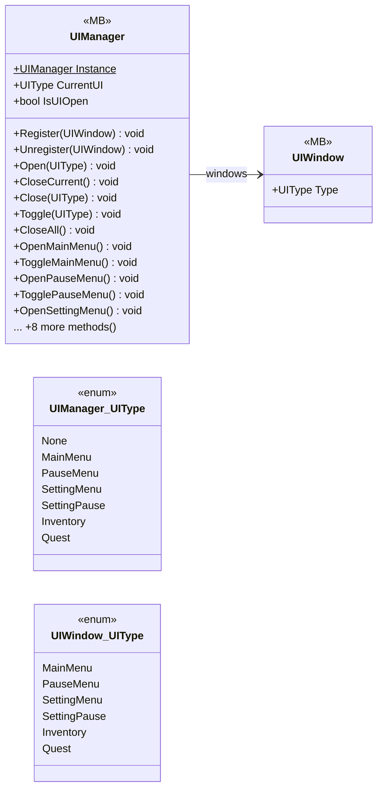

# UI/UIManager

4 types · 399 LOC (non-blank) · depends on: [UI](UI.md) ×5, [Gameplay/QuestSystems/Quest](Gameplay_QuestSystems_Quest.md) ×4, [Gameplay/Cutscenes](Gameplay_Cutscenes.md) ×1, [Core](Core.md) ×1

[← index](../README.md)

## Files

| Type | Kind | File | LOC |
|---|---|---|---|
| UIManager | MB | `UIManager.cs:21` | 362 |
| UIManager_UIType | enum | `UIManager.cs:24` | 10 |
| UIWindow | MB | `UIWindow.cs:5` | 37 |
| UIWindow_UIType | enum | `UIWindow.cs:6` | 9 |
