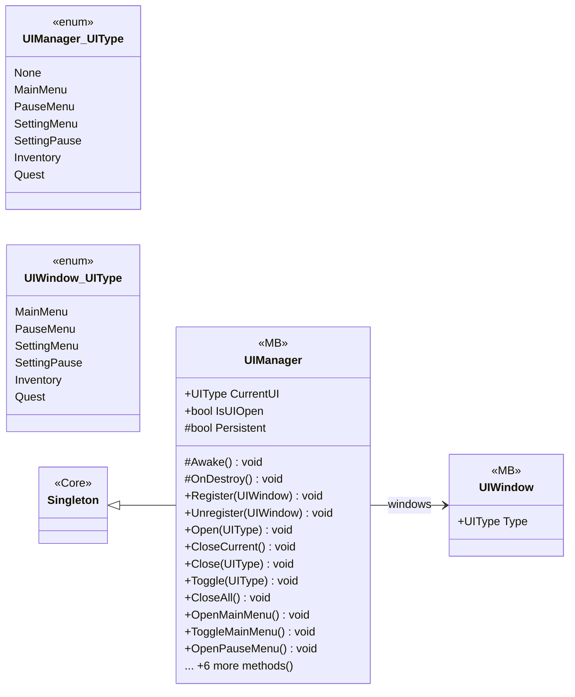

# UI/UIManager

4 types · 385 LOC (non-blank) · depends on: [Core](Core.md) ×3, [UI](UI.md) ×3, [Gameplay/Inventory](Gameplay_Inventory.md) ×2, [Gameplay/QuestSystems/Quest](Gameplay_QuestSystems_Quest.md) ×2, [Gameplay/Cutscenes](Gameplay_Cutscenes.md) ×1, [Gameplay/Game](Gameplay_Game.md) ×1

[← index](../README.md)

## Event subscriptions

| Subscriber | Publisher | Event |
|---|---|---|
| UIManager | GameManager | OnReturningToMenu |

## Files

| Type | Kind | File | LOC |
|---|---|---|---|
| UIManager | MB | `UIManager.cs:23` | 348 |
| UIManager_UIType | enum | `UIManager.cs:25` | 10 |
| UIWindow | MB | `UIWindow.cs:7` | 37 |
| UIWindow_UIType | enum | `UIWindow.cs:8` | 9 |
