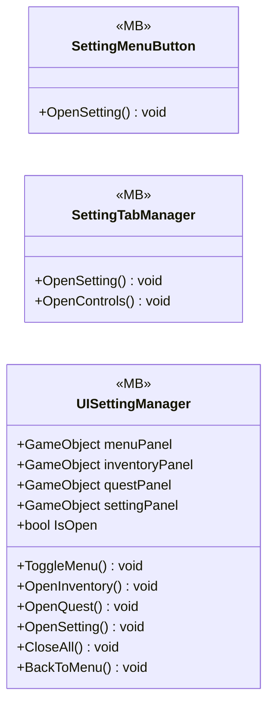

# UI/UIMenuSetting

3 types · 137 LOC (non-blank) · depends on: [UI/UIManager](UI_UIManager.md) ×2

[← index](../README.md)

## Files

| Type | Kind | File | LOC |
|---|---|---|---|
| SettingMenuButton | MB | `SettingMenuButton.cs:7` | 12 |
| SettingTabManager | MB | `SettingTabManager.cs:8` | 33 |
| UISettingManager | MB | `UISettingManager.cs:7` | 92 |
